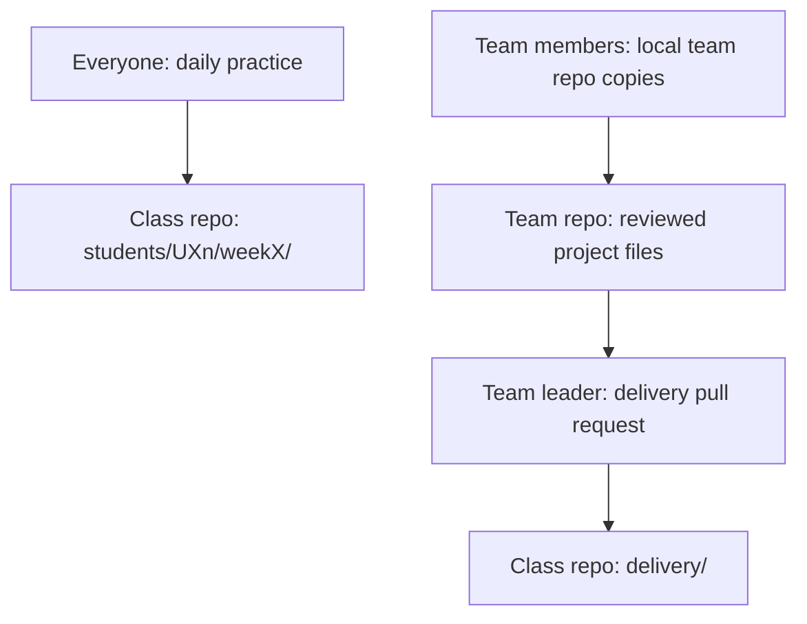

# Team Project Repo and the Delivery Folder

This guide shows how your team works together in one shared repo, and how reviewed work reaches the class repo `delivery/` folder.

## 1. What We Are Doing

You and your team (at most 10 designers, codes UX1 to UX10) put the real sprint work into one shared team repo. A repo (short for repository) is a folder that stores files and their full history in Git. You also learn how the team leader copies reviewed files into the class repo `delivery/` folder, so the shared record stays clean.

You use two places:

- Your practice folder: `Design-Sprint-N/students/UX{n}/weekX/`.
- Your team project repo: the real project files for this sprint.

Replace `N` with the sprint number, `n` with your student number, such as `UX4`, and `X` with the week ID. The week ID can be `0`, a number from `1` to `24`, `12b` or `20b`. So `Design-Sprint-1/students/UX4/week0/` is week 0 of sprint 1.

Inside the class repo, `delivery/` is the shared, client-facing folder for the sprint. Strict review applies (system owner plus admin). Nothing there is one person's practice work. Only the team leader copies files into it.

## 2. Why We Are Doing It

In a real design job in India, you rarely work alone. A product team keeps design files, research notes and handoff specs in one repo. Engineers pull from it. The client-facing folder is the record you show at the end. When a hiring manager asks "how did the team deliver?", you open the delivery folder and the pull request history.

This week matters for your portfolio because review is a skill. A designer who takes feedback, keeps files tidy and hands over clean work gets hired faster than one who only makes pretty screens.

Keeping `delivery/` clean also protects the group. One wrong file, one real name, or one 40 MB screenshot breaks the shared record for everyone.

This is new for most people. Go slowly.

## 3. What to Learn First

| Before you start | What you need |
|---|---|
| VS Code | Open a folder and open its terminal. |
| Git | Make a commit and understand a branch. |
| GitHub | Sign in and open a pull request. |
| Class repo | Have your fork and your local clone. |
| Team | Know who leads the current week. |
| Figma or Penpot | Know how to share a frame with a view-only link. |

Short words you will see:

- A commit records a change in Git.
- A branch keeps a set of changes separate while you work.
- A pull request asks someone to review a branch before merging it.
- A remote is a named connection to another Git repo.
- A clone is a local copy of a repo.
- A merge conflict means Git needs help choosing the final file content.

By the end of this guide you can:

- Create and share a team design repo.
- Save project files in the correct folder.
- Keep `.fig` files, secrets and real personal data out of Git.
- Send reviewed work to the class repo `delivery/` folder.
- Follow the team review routine every week.

## 4. Where to Find Resources

> **Where you work**
>
> Write and save files in VS Code.
> Run Git commands in the VS Code terminal.
> Use GitHub in your browser for repos and pull requests.
> Design and export in Figma. Use Penpot as the backup.
> Figma or Penpot holds the source design. The repo holds the exported files and the written work.

| Resource | Use it for |
|---|---|
| [04-Tools-Setup.md](04-Tools-Setup.md) | Figma, Penpot, VS Code and Git setup. |
| [10-GitHub-For-Designers.md](10-GitHub-For-Designers.md) | Fork, clone, branch, commit, pull request. |
| [Design-Sprint-1/delivery/README.md](Design-Sprint-1/delivery/README.md) | The five delivery folders. |
| [10-GitHub-For-Designers.md](10-GitHub-For-Designers.md) | Class repo rules. |
| [Figma plans and features](https://help.figma.com/hc/en-us/articles/360040328273-Figma-plans-and-features) | Why we keep one Figma file per sprint. |
| [Penpot](https://penpot.app/) | Backup when the Figma file limit blocks you. |
| [web.dev/learn/images](https://web.dev/learn/images) | Image formats and file size. |
| [Git book](https://git-scm.com/book/en/v2) | Branches, remotes and merging. |
| [GitHub docs](https://docs.github.com) | Repos and pull requests. |

Search keywords: `git pull request review`, `resolve merge conflict`, `git large binary file`, `figma export png size`, `github file size limit`.

## 5. Step-by-Step Guide

One task, one commit containing all files listed for that task. Put the task ID at the start of every commit message and every pull request title. See [10-GitHub-For-Designers.md](10-GitHub-For-Designers.md) for the base Git steps.

### 5.1 Two places for your work

Everyone commits practice work every day. Practice files go inside `Design-Sprint-N/students/UX{n}/weekX/`. The team repo holds the files that build the real sprint project.



1. Open your class repo fork for individual practice.
2. Save practice files under `students/UX{n}/weekX/`.
3. Commit each finished practice task.
4. Open your local team repo copy for the real project work.
5. Send project changes through a pull request inside the team repo.
6. Let the leader deliver the reviewed files to the class repo.

> **Check it worked**
>
> You can say which repo is open in VS Code. Practice files sit in your own week folder. Project files sit in the team repo.

### 5.2 Create the team design repo

One person creates the shared repo first. Everyone else clones it. Do not create separate GitHub repos for the same team project.

If Git is not installed: on Mac, open Terminal and run `xcode-select --install`, or install from [git-scm.com](https://git-scm.com/). On Windows, download the installer from [git-scm.com](https://git-scm.com/) and run it, then use Git Bash for the commands below.

1. Open VS Code.
2. Choose **File > Open Folder**.
3. Create a new folder named `design-team-repo`.
4. Open that folder.
5. Open the VS Code terminal: **View > Terminal**, or press Control and the backtick key on Mac and on Windows.
6. Run `git init`.
7. Create `README.md`.
8. Add this starter text.

```markdown
# Design Team Repo

## Purpose
Record the sprint goal in one or two lines.

## Team
Record the member codes (UX1 to UX10) and this week's roles.

## Folder guide
Describe each project folder.

## Setup
Record setup steps. Never record passwords or tokens.

## How to run
Record how to open the Figma or Penpot file and export a screen.

## Milestones
Record progress for the weeks in your sprint plan.

## Handover
Record the final handoff notes and known limits.
```

9. Create `.gitignore`.
10. Add these lines.

```gitignore
.env
*.fig
.DS_Store
Thumbs.db
```

`.fig` is the Figma design file. Never commit it. `.DS_Store` is a Mac folder settings file. `Thumbs.db` is a Windows thumbnail file. Both are junk in a repo.

11. Review the files with `git status`.
12. Stage the starter files with `git add README.md .gitignore`.
13. Open GitHub in your browser.
14. Open your account settings.
15. Open the Emails page.
16. Copy your GitHub no-reply email address.
17. Set it as your commit email with `git config user.email "YOUR_GITHUB_NOREPLY_EMAIL"`.
18. If you use [GitHub Desktop](https://desktop.github.com/), open Settings and paste the same no-reply email in the email field. (check before use)
19. Make the first commit. Replace `TASK_ID` with the task ID from your week file.

```bash
git commit -m "TASK_ID create team design repo"
```

20. Name the main branch with `git branch -M main`.
21. Create an empty repo on GitHub.
22. Copy its repository URL.
23. Add the remote. Replace `TEAM_REPO_URL` with the copied URL.

```bash
git remote add origin TEAM_REPO_URL
```

> **Sign-in note**
>
> GitHub does not accept your account password for pushes. Use browser sign-in or GitHub Desktop.

24. Push the first commit with `git push -u origin main`.
25. Open the team repo on GitHub.
26. Invite every member with **write** access.
27. Look on the repo settings page for the collaborators or access page. Menu names change, so follow [GitHub docs](https://docs.github.com) if yours differs.
28. Tell each member to accept the invitation, by email or on GitHub.
29. Wait until every member accepts. They cannot push until they accept.

Use this layout as the project grows.

```text
design-team-repo/
├── README.md
├── .gitignore
├── research/
├── design/
├── handoff/
├── prototype/
└── presentation/
```

Create each folder when the task that needs it starts. Git does not save empty folders in a commit. Add one README line when each folder starts.

Other team members follow these steps:

1. Accept the GitHub invitation.
2. Copy the team repo URL.
3. Open the VS Code terminal in the folder that will hold the project.
4. Run `git clone TEAM_REPO_URL`.
5. Open the cloned folder with **File > Open Folder**.

Optional: in [GitHub Desktop](https://desktop.github.com/) use **File > Clone repository** on Mac and Windows instead of the clone command.

If you get stuck:
- Read the terminal text. It usually names the exact command and the reason.
- Run `git remote -v`. It must show the team repo URL.
- Read [04-Tools-Setup.md](04-Tools-Setup.md) and [10-GitHub-For-Designers.md](10-GitHub-For-Designers.md).
- Ask in Discord with the error text, the command you ran and the folder path. Mac paths start `/Users/...`, Windows paths start `C:\Users\...`.

> **Check it worked**
>
> GitHub shows the README and `.gitignore`. Every member can open their local clone. `git remote -v` shows the team repo.

### 5.3 The five delivery folders

The class repo `delivery/` folder is shared per sprint. It has five subfolders.

| Folder | Contents |
|---|---|
| `research/` | Shared class research outputs |
| `design/` | The final shared design files, exported |
| `handoff/` | The handoff spec an engineer could build from |
| `prototype/` | The clickable prototype and its recordings |
| `presentation/` | Slides and notes for the client or department |

Your team repo uses the same five names, so the copy step is simple.

| Team repo source | Class repo destination |
|---|---|
| `research/` | `delivery/research/` |
| `design/`, exported screens | `delivery/design/` |
| `handoff/` | `delivery/handoff/` |
| `prototype/` and its recordings | `delivery/prototype/` |
| `presentation/` | `delivery/presentation/` |
| `README.md`, the setup and export notes | a named `README.md` inside the same destination, for example `delivery/design/README.md` |

Copy only the files needed for the delivery. Never copy `.fig` files, `.env` files, tokens or real personal data. The destination README explains how that folder is used.

> **Check it worked**
>
> You can name all five folders without looking. You know which team folder feeds each one.

### 5.4 Team roles and the weekly routine

| Role | Weekly responsibility |
|---|---|
| Leader | Reviews team work, runs the merge, opens the class delivery pull request. |
| Reviewer | Checks changes, file paths, file names and missing explanations. |
| Note taker | Records decisions, sources and open questions in the team `README.md`. |

1. Choose the week's leader.
2. Choose the week's reviewer.
3. Choose the week's note taker.
4. Record the three roles in the team `README.md`.
5. Rotate roles the next week where possible.

Only the current leader updates the class `delivery/` folder. Nobody else touches it. Nobody edits it directly on the GitHub website.

The weekly routine:

- Start of week: set the roles, read the week file, split the tasks.
- During the week: one task, one branch, one pull request in the team repo.
- Mid week: the reviewer reads the open pull requests and comments.
- End of week: the team reviews the merged work, then the leader copies the reviewed files into `delivery/` and opens the delivery pull request.

> **Check it worked**
>
> Everyone knows their role. The team README names this week's leader, reviewer and note taker.

### 5.5 Team member routine

Replace `YOUR_BRANCH` and `path/to/file` with your branch name and file name. Your branch name must contain the task ID or the week, for example `ux1-week0-z0-5`. Use the same commands on Mac and Windows in the VS Code terminal.

1. Check your files with `git status`.
2. Finish current work before you switch branches.
3. Switch with `git switch main`.
4. Pull with `git pull origin main`.
5. Create a branch with `git switch -c YOUR_BRANCH`, for example `git switch -c ux1-week0-z0-5`.
6. Make one small change.
7. Review it with `git diff`.
8. Stage it with `git add path/to/file`.
9. Commit with the task ID and a short action, for example `git commit -m "TASK_ID add research summary"`.
10. Push with `git push -u origin YOUR_BRANCH`.
11. Open a pull request inside the team repo.
12. Ask the leader or reviewer to review it.
13. Address the review comments with a new commit on the same branch.

If you get stuck:
- Run `git status` again and read the first line.
- Check you are on your branch, not on `main`.
- Ask in Discord with a screenshot of `git status` and what you tried.

> **Check it worked**
>
> Your pull request targets the team repo, not the class repo. The reviewer can read the change before merging.

### 5.6 Pull request review rules

These rules apply to the author and to the reviewer.

Author:

1. Keep the pull request small. One task, or one small group.
2. Start the title with the task ID.
3. Write three lines in the body: what changed, why, and which file to open first.
4. Add the view-only Figma or Penpot link in the body when the work lives in Figma or Penpot.
5. Attach one small PNG under 2 MB only if it helps the reviewer.
6. Reply to every comment.
7. Push a new commit to the same branch.
8. Do not open a second pull request.

Reviewer:

1. Open every changed file. Reading the file list is not a review.
2. Check the folder path: `research/`, `design/`, `handoff/`, `prototype/` or `presentation/`.
3. Check file names: lowercase, hyphens, no spaces, for example `r1-1-home-page.png`. The one exception is `README.md`, which keeps its capital letters.
4. Check that no real names, faces, phone numbers or IDs appear. Participants are P1, P2.
5. Check that the Figma or Penpot link opens in view only.
6. Check that nothing under `delivery/` was edited by a member.
7. Write one clear ask per comment.
8. Say what to change, not only that something is wrong.

Do not squash-merge. The commit history should show each step.

If you get stuck:
- Read the comment again and reply with a question if it is unclear.
- Search the keyword `git pull request review`.
- Ask in Discord and tag the reviewer. Attach a screenshot of the file and the comment.

> **Check it worked**
>
> Each pull request has a task ID in the title, a short body and at least one review comment. The reviewer opened the files.

### 5.7 Team leader routine: update the class repo

Do this at the end of the week, after the team review. Run the commands in your local class repo. Here `origin` is your class fork and `upstream` is the class repo. Check both with `git remote -v` before you start. If `upstream` is missing, follow [10-GitHub-For-Designers.md](10-GitHub-For-Designers.md).

1. Check for unfinished local changes with `git status`.
2. Finish current work before you change branches.
3. Switch with `git switch main`.
4. Pull the class updates with `git pull upstream main`.
5. Create the delivery branch with `git switch -c delivery_weekX`. For week 6 the name is `delivery_week6`.
6. Copy only the reviewed team files, using the mapping table in 5.3.
7. Check the copied files with `git status`.
8. Open each new file in VS Code and read it.

`git diff` shows changes to tracked files only. It does not show the contents of newly copied files that Git does not track yet. So always open new files by hand.

9. Run the checklist in 5.8.
10. Stage the first reviewed delivery file by its exact path, for example `git add delivery/design/r2-4-flow.png`.
11. Stage each next file by its exact path, one command per file. Do not run `git add .`.
12. Review the staged text changes with `git diff --cached`. This view shows staged text changes. It does not show the inside of an image or a PDF.
13. Open each staged PNG, JPG or PDF file in an image viewer or a PDF viewer and check the contents.
14. Commit with the command below. Replace `TASK_ID` and `X`.

```bash
git commit -m "TASK_ID deliver reviewed team files for week X"
```

15. Push with `git push -u origin delivery_weekX`.
16. Open a pull request to the class repo.
17. Put the same task ID at the start of the title.
18. Describe the delivered files in the body.
19. Wait for review before merging.

If you get stuck:
- Run `git remote -v` and confirm which remote is the class repo.
- Run `git status` and read the first line.
- Ask in Discord with the file list and the error text, and remove secrets from anything you share.

> **Check it worked**
>
> The pull request shows only reviewed delivery changes. Nothing outside `delivery/` changed. The merge does not squash the commits.

### 5.8 What the team leader checks before a merge

Before every delivery pull request:

- [ ] The team has reviewed the source files.
- [ ] The files match the current team project.
- [ ] Each file sits in the correct destination folder.
- [ ] Every file name is lowercase, with hyphens and no spaces. `README.md` keeps its capital letters.
- [ ] Every image is under 2 MB and every PDF is under 10 MB.
- [ ] Only markdown, PNG/JPG, PDF, small `.html`, `.css` and `.js` files in task code folders, and view-only links are delivered.
- [ ] No `.fig` files, no `.env` files, no tokens, no passwords.
- [ ] No real names, faces, phone numbers or IDs. Participants are P1, P2.
- [ ] Figma or Penpot links open in view only, and the link sits inside a markdown file.
- [ ] The team README notes have a named `README.md` at the destination.
- [ ] Every new file was opened in VS Code and `git diff --cached` was reviewed.
- [ ] Every staged image or PDF was opened and checked.
- [ ] The pull request title starts with the task ID and describes what changed.

If you get stuck:
- Re-read this list and tick items one by one in a note.
- Search the keyword `github file size limit`.
- Ask the system owner in Discord before you merge, not after.

> **Check it worked**
>
> You can tick every box. If one box is empty, fix it before you ask for review.

### 5.9 Merge conflicts

A merge conflict means two people changed the same file. Text files can be fixed. Image files cannot be merged, so you pick one version.

1. Read the error and run `git status`.
2. Ask the leader or reviewer to compare the changes with you.
3. Agree on the final content before you edit anything.
4. Open the file in VS Code.
5. Remove the conflict markers: `<<<<<<<`, `=======`, `>>>>>>>`.
6. Keep only the agreed content.
7. Save the file.
8. Stage each fixed file by name, for example `git add path/to/file`.
9. Run `git status`.
10. Read the conflict list. It must show no unresolved conflicts.
11. Follow the instruction Git prints to finish the merge.

For an image file, two versions cannot be merged. Follow these steps.

1. Export the image again from the source design, so both current versions exist as separate files on your computer.
2. Open both files side by side in an image viewer.
3. Agree with the team which version stays.
4. Save the agreed version at the original path in the repo.
5. If the team needs the second version, save it under a new name with your member code, for example `r2-4-flow-ux3.png`.
6. Stage the exact paths, for example `git add r2-4-flow.png`.
7. Stage the second path if you kept it, for example `git add r2-4-flow-ux3.png`.

If you get stuck:
- Run `git status` and read which files are listed as both modified.
- Search the keyword `resolve merge conflict`.
- Ask in Discord with the file name, a screenshot of the markers and what you tried.

> **Check it worked**
>
> The file holds the agreed content. `git status` shows no unresolved conflicts.

### 5.10 Large images and file size

Screenshots are the most common reason a repo becomes slow. Follow these rules.

1. Keep the source in your Figma file, or in your Penpot file. One Figma file per sprint, named `SPRINT-N UX{n}`, with one page per week.
2. Export only the frames the delivery needs.
3. Export a PNG for screens with text. Use JPG for photos.
4. If a file is over 2 MB, resize it smaller, crop it, or export JPG instead.
5. Check the size before you commit. On Mac, select the file in Finder and press Cmd and I. On Windows, right click the file and open **Properties**.
6. Name the file with lowercase letters and hyphens, for example `r1-1-home-page.png`.
7. Share a view-only Figma or Penpot link inside a markdown file instead of committing many screenshots.
8. Record a walkthrough with free Loom and put the link in a markdown file, not the video file.

If a large file is already committed, tell the leader before you push more work.

If you get stuck:
- Read [web.dev/learn/images](https://web.dev/learn/images) on formats and size.
- Search the keyword `figma export png size`.
- Ask in Discord with the file name and the size.

> **Check it worked**
>
> Every image is under 2 MB. Every PDF is under 10 MB. No `.fig` file is in the repo.

### 5.11 If you are stuck

1. Read the error text or the review comment again, slowly.
2. Run `git status` and read the first line.
3. Open the matching guide: [04-Tools-Setup.md](04-Tools-Setup.md) or [10-GitHub-For-Designers.md](10-GitHub-For-Designers.md).
4. Try one search keyword from section 4.
5. Ask in Discord. Include a screenshot, the command you ran and what you already tried.

> **Check it worked**
>
> You asked with enough detail for someone to help you in one reply.

## 6. What to Commit

Final checklist for the team repo and the delivery folder.

- [ ] The team repo exists on GitHub, with a README and a `.gitignore`.
- [ ] Every member was invited with write access and accepted before cloning.
- [ ] Every member set the GitHub no-reply email as the commit email.
- [ ] The team README names this week's leader, reviewer and note taker.
- [ ] Each member worked on a branch and opened a pull request inside the team repo.
- [ ] Each branch name contains the task ID or the week, for example `ux1-week0-z0-5`.
- [ ] Each pull request title starts with the task ID.
- [ ] Each pull request was reviewed by a second person before the merge.
- [ ] No pull request was squash-merged.
- [ ] Files sit in `research/`, `design/`, `handoff/`, `prototype/` or `presentation/`.
- [ ] File names are lowercase, with hyphens and no spaces. `README.md` keeps its capital letters.
- [ ] Images are under 2 MB, PDFs are under 10 MB.
- [ ] Only markdown, PNG/JPG, PDF, small `.html`, `.css` and `.js` files in task code folders, and view-only Figma or Penpot links inside markdown are committed.
- [ ] No `.fig` files, no `.env` files, no tokens, no passwords.
- [ ] No real names, faces, phone numbers or IDs. Participants are P1, P2.
- [ ] Only the team leader updated the class repo `delivery/` folder.
- [ ] The leader staged each delivery file by its exact path, not with `git add .`.
- [ ] The leader opened the delivery pull request, with the task ID in the title.
- [ ] The delivery pull request was reviewed before merging.
- [ ] Conflicts were fixed with the team, then staged by file name.

Next: keep the routine running every week. Rotate the roles, and check the `delivery/` folder before each new sprint starts.
