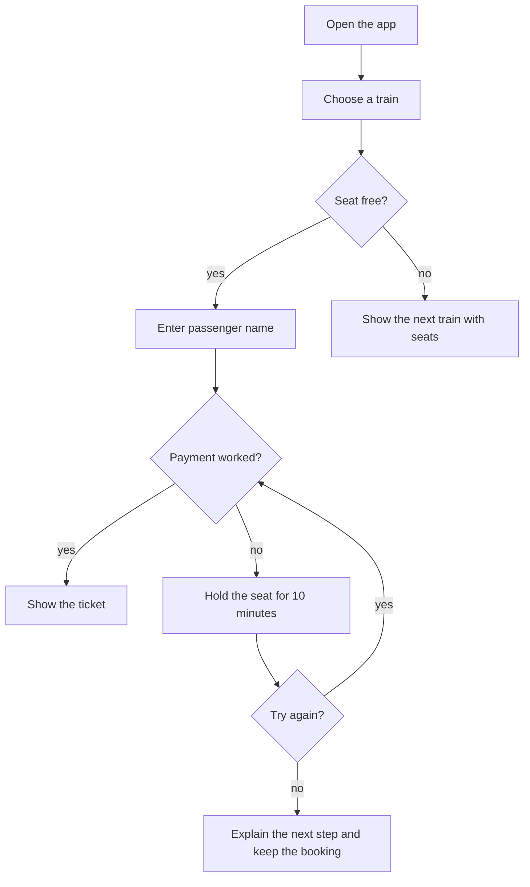

# Week 2 - Build

**Sprint 1, Week 2 of 4. Theme: forms, error messages, and the whole apply flow at mid fidelity.**

## Week at a Glance

| Task ID | Task name | Time | File you will commit |
|---|---|---:|---|
| LEARN 1-5 | Learning summaries | 6 h 45 min | `students/UX{n}/week2/session1-learning.md` to `session5-learning.md` |
| P2.1 | Draw the full flow | 90 min | `students/UX{n}/week2/P2-1-flow.md` |
| P2.2 | The can't-get-in path | 90 min | `students/UX{n}/week2/P2-2-cant-get-in-path.md` |
| P2.3 | Form structure decision | 45 min | `students/UX{n}/week2/P2-3-form-structure-decision.md` |
| C3.1 | Happy path at mid fidelity | 2 h 30 min | `students/UX{n}/week2/C3-1-happy-path-mobile.md` |
| C3.2 | Photograph and signature guidance | 45 min | `students/UX{n}/week2/C3-2-photo-and-signature-guidance.md` |
| C3.3 | Check your answers | 45 min | `students/UX{n}/week2/C3-3-check-your-answers.md` |
| C4.1 | Error inventory for the apply flow | 45 min | `students/UX{n}/week2/C4-1-error-inventory.md` |
| C4.2 | Write every error message | 75 min | `students/UX{n}/week2/C4-2-error-messages.md` |
| Critique | Critique session | 90 min | Notes in your week 2 files |
| C3.4 | Photograph upload states | 40 min | `students/UX{n}/week2/C3-4-upload-states.md` |
| C4.3 | Submission acknowledgement | 35 min | `students/UX{n}/week2/C4-3-confirmation-copy.md` |
| C4.4 | Plain language pass | 30 min | `students/UX{n}/week2/C4-4-plain-language.md` |
| S2.1 | Contribute one component | 90 min | `system/components/{component}.md` plus Figma component |
| S2.2 | Review one peer's component | 30 min | `system/docs/review-log.md` plus PR comment |
| F2.1 | Why session: hierarchy and whitespace | 60 min | `fundamentals/why-sessions/week02-hierarchy.md` |
| F2.2 | Teardown: electricity bill payment flow | 45 min | `fundamentals/teardowns/02-electricity-payment.md` |
| F2.3 | Drill continues | 10 min/day | Same drill log file from week 1 |
| L-AI1 | Options to react against | 90 min | `students/UX{n}/week2/L-AI1-options.md` |

About 25 hours of work in this week.

## 1. What We Are Doing

This week you design the Kerala PSC "apply for a post" flow on a phone, in Malayalam and English. You draw the full flow, design the form screens, and write clear error messages. You also add one shared component to the system.

Task groups:
- Group 0, Days 1 to 5: LEARN 1-5
- Group 1, Day 1: P2.1, P2.2
- Group 2, Day 2: P2.3, C3.1
- Group 3, Day 3: C3.2, C3.3
- Group 4, Day 4: C4.1, C4.2, Critique
- Group 5, Day 5: C3.4, C4.3, C4.4
- Group 6, Day 6: S2.1, S2.2, F2.1, F2.2, F2.3, L-AI1

## 2. Why We Are Doing It

A working product designer in India often designs government and finance forms. These forms are high stakes. A wrong photo, a lost session, or a bad error message can make a person lose an exam cycle or a payment. Clear form design and clear error messages reduce support calls and help people finish alone.

For your project and portfolio, this week shows that you can design the failure paths, not only the happy path. It shows systems thinking, accessibility, plain language, and care for real users. These are strong portfolio signals.

## 3. What to Learn First

By the end of this week you can:
- Draw the full apply flow, with every place where it can fail
- Design a screen where every field has a label, a hint, and a clear rule
- Write an error message that says what happened, why, and what to do next
- Write the same message in English and in Malayalam, and check it with a Malayalam speaker
- Add one documented component to the shared design system

Two words we use all week. The **happy path** is the flow when nothing goes wrong. A **failure path** is any other route, for example "the photo is rejected" or "the password is forgotten".

Core ideas to review first:
- A placeholder is not a label. Placeholder text disappears when the person types.
- Put the label above the field on a phone.
- Show most errors after the person presses Submit. Check the format early only when the person cannot guess it, for example a date.
- One page and short steps have a tradeoff: mental load, fixing mistakes, page loads on slow data, session timeout.
- Help comes before the choice, not after the mistake.
- A check-your-answers screen shows short rows. Each row has a label, a value, and a Change link.
- An error message has three jobs: say what happened, say why, say what to do next.
- Plain language keeps facts and cuts extra words.
- A component needs states, reasons for variants, keyboard behaviour, screen reader behaviour, and a matching HTML element.
- Mid fidelity means real words, real type, real spacing. No polish.

## 4. Where to Find Resources

Your week in order:

| Day | Source | What exactly | Time |
|---|---|---|---:|
| 1 | **Form Design Patterns**, Adam Silver | Ch. 1 "A Registration Form". Labels, placeholders, floating labels, and when to show an error. | 50 min |
| 1 | **mermaid.live** | The flowchart syntax page: https://mermaid.live/ . You need `graph TD`, boxes, and arrows with words. | 20 min |
| 1 | Your own R1.2 | Read your heuristic audit from last week again. | 20 min |
| 2 | **Figma Learn** | "Variants" and "Component properties": https://help.figma.com/ . A variant is one version of a component, for example its error version. Read this before C3.1. | 35 min |
| 2 | **Form Design Patterns** | Ch. 2 "A Checkout Form". One long page compared with short steps. Grouping fields. Book list: `../03-Books-And-Resources.md`. | 50 min |
| 2 | **GOV.UK Design System** | "Text input" https://design-system.service.gov.uk/components/text-input/ and "Error summary" https://design-system.service.gov.uk/components/error-summary/ . | 25 min |
| 2 | **Refactoring UI** | Ch. 3 "Avoid ambiguous spacing": group fields with space, not borders. Book in repo folder `Resources/`. | 15 min |
| 3 | **GOV.UK Design System** | The "Check answers" pattern page. Read the summary list and change links. | 30 min |
| 3 | **Form Design Patterns** | Ch. 3 "A Flight Booking Form". Help a person choose before they act. | 30 min |
| 3 | **Shopify Polaris** | "Help text" and "Inline error" content guidance: https://polaris.shopify.com/content . | 30 min |
| 4 | **NNGroup** | "Error Message Guidelines": https://www.nngroup.com/articles/error-message-guidelines/ . Keep your error list open. | 20 min |
| 4 | **Shopify Polaris** | "Error messages" part of the content guidance: https://polaris.shopify.com/content . | 20 min |
| 4 | **GOV.UK** | "Error message" component page: https://design-system.service.gov.uk/components/error-message/ . | 20 min |
| 4 | Your R1.2 | Read every finding you rated 3 or 4. Ask: could this cause an error? | 15 min |
| 5 | **Shopify Polaris** | One component page at https://polaris.shopify.com/content . See how much detail it gives. | 25 min |

Takeaways:
- Day 1: a placeholder is not a label. Show most errors after Submit. Check format early only when the person cannot guess it.
- Day 2: one thing per page lowers mental load. Steps make a mistake cheap to fix, but add page loads. On slow mobile data, every page load can fail. State this tradeoff in P2.3. Read the Figma components row on Day 2, before you build C3.1.
- Day 3: good guidance comes before the choice, not after the mistake. If a rule only appears in an error message, the design lets the person fail first.
- Day 4: an error message has three jobs. Say what happened. Say why. Say what to do next. Many messages do only one job. Some do none.
- Day 5: a variant is one version of a component. Polaris shows how much content detail to write.

Tools you open this week: a browser for https://mermaid.live/ , then Figma first in C3.1. Figma setup: see the Figma section in `../04-Tools-Setup.md`. Penpot is the backup: see the Penpot section in `../04-Tools-Setup.md`.

> **Figma file hygiene:** Use ONE Figma file per sprint named `SPRINT-1 UX{n}`. Keep one page per week, named `Week 2`. Do not make three Figma files per sprint. Use your one spare file only if needed. If the Figma 3-file limit blocks you, use Penpot. Ask the admin about the Education plan, but do not assume it is available.

> **Kerala PSC rule:** Use public pages only. Never log in, register, apply or submit. Save screenshots as a fixed record. Start with https://www.keralapsc.gov.in/notifications for post names, https://www.keralapsc.gov.in/tips-applicants for official steps, and https://www.keralapsc.gov.in/confirmation-procedures for the confirmation step. Look for One Time Registration, Apply Now, CONFIRM NOW, and OTP. If the site changed, note the date and keep working from your week 1 screenshots.

Search keywords if you are stuck:
- Mermaid flowchart syntax
- GOV.UK check answers pattern
- error message plain language
- Figma variants component properties
- focus visible contrast WCAG
- Malayalam form label wrapping

## 5. Step-by-Step Guide

> All `students/...` paths in this week are inside your sprint folder (`Design-Sprint-N/`). Open a terminal in the repo root and use full paths.

One task, one commit containing all files listed for that task. See `../10-GitHub-For-Designers.md`. Allowed files: markdown (.md), small .html, .css and .js files for code corners (kept in a code folder such as `week12b/page/`), PNG/JPG under 2 MB, PDF under 10 MB, and a view-only Figma or Penpot link written inside a markdown file. Never commit .fig files, passwords, tokens, or real personal data.

### Group 0 - Days 1 to 5: Learning summaries

#### Task - Five learning summaries (ID `LEARN 1-5`)

##### 1. What We Are Doing
Write one short summary after each day's reading. Five summaries, five files, in your own words.

##### 2. Why We Are Doing It
Writing in your own words is how you find out if you understood the reading. Next week you need these rules fast, and your own summary is faster to read than the book.

##### 3. What to Learn First
How to write a summary: one idea per line, your own words, no copy-paste. Always keep the source name, the chapter or page, and the date.

##### 4. Where to Find Resources
The Day 1 to Day 5 rows in Section 4. Take the source name from the row you read.

##### 5. Step-by-Step Guide
Before you start: the reading for that day done. About 60 to 80 minutes a day, 6 h 45 min in total for the week.

How to think about it: if a friend asked "what did you read today?", what would you say in five lines? Write that.

1. Read the Day 1 sources in Section 4.
2. Open a new file `students/UX{n}/week2/session1-learning.md`.
3. Write the source name, the chapter or page, and the date.
4. Write five to eight lines in your own words: what the source says, and where you will use it this week.
5. Answer these two prompts in one line each: "What was the main rule in this reading?" and "Which screen in this week does it change?".
6. Write one line on what you did not understand yet.
7. Save the file. Commit it with `LEARN 1 add session 1 learning summary`.
8. Repeat steps 1 to 7 for Day 2, in `session2-learning.md`.
9. Repeat for Day 3, in `session3-learning.md`.
10. Repeat for Day 4, in `session4-learning.md`.
11. Repeat for Day 5, in `session5-learning.md`. Use the commit message shown in Section 6 below.

If you get stuck: read the takeaways under the Day table in Section 4. Search the source name plus the topic. Ask in Discord with the one line you could not write.

##### 6. What to Commit
Paths: five files, `students/UX{n}/week2/session1-learning.md` to `session5-learning.md`.

Done when:
- [ ] Five files, one per day
- [ ] Each file names its source, the chapter or page, and the date
- [ ] Each file has five to eight lines in your own words, not copied text
- [ ] Each file answers the two prompts
- [ ] Each file has one line on what you did not understand yet

Files: .md.
Commit message: `LEARN 1 add session 1 learning summary`, then `LEARN 2 add session 2 learning summary`, `LEARN 3 ...`, `LEARN 4 ...`, `LEARN 5 add session 5 learning summary`. One commit per summary.

### Group 1 - Day 1: Flow and recovery

#### Task - Draw the full flow (ID `P2.1`)

##### 1. What We Are Doing
Draw one diagram of the whole "apply for a post" journey. Show every step and every way the journey can fail.

##### 2. Why We Are Doing It
A diagram shows gaps fast. In a real job, a team can argue about screens for days. One flow diagram shows the missing step in a minute.

##### 3. What to Learn First
Mermaid flowchart syntax from Day 1 LEARN. You need `graph TD`, boxes, diamonds, and arrows with words. Also review happy path and failure path.

##### 4. Where to Find Resources
See Day 1 LEARN in Section 4. Use your R1.1 screenshots and R1.2 findings. Keep `01-project-brief.md` open at section 4. Links: https://mermaid.live/ , https://www.keralapsc.gov.in/notifications , https://www.keralapsc.gov.in/tips-applicants , https://www.keralapsc.gov.in/confirmation-procedures , and the confirmation PDF https://www.keralapsc.gov.in/sites/default/files/inline-files/confirmation_0.pdf . Look only for button names.

##### 5. Step-by-Step Guide
Before you start: about 90 minutes. Mermaid is a text tool. You write plain words and it draws boxes.

How to think about it: ask at each box "What does the candidate see next, and what can go wrong here?" Ask "Can the person go back?" Rule: one box is one screen or one clear moment.

1. Draw the happy path first. Start at "find the notification" and end at "admission ticket".
2. Build the step order from public evidence, not from memory. Use the public pages and the screenshots you saved in week 1. Write each step you can support from them.
3. If a step is likely but you have no evidence for it, write "not seen" inside that box. Do not invent the order.
4. Explain the two special steps in your own words, using the public pages: One Time Registration, and the confirmation step. Write the page you used for each.
5. Mark each decision point as a diamond with a question inside, for example "Is this the right post for you?" or "Does the photo meet the rules?".
6. Add failure paths. Include at least: wrong post chosen, cannot log in, photo rejected, network drops during upload, session ends, submit done but confirmation missed, confirmation window closed.
7. Write words on every arrow. A reader should see why the path splits.
8. Check that no branch ends in a box that only says "Error". End each branch with what the person can do next.
9. If you did not see a screen yourself, write "not seen" inside that box. Do not draw what you cannot support.
10. Paste the text into https://mermaid.live/ and fix anything that does not render.

Verify yourself: read https://www.keralapsc.gov.in/confirmation-procedures and the PDF it links to. Find where the public pages state when the confirmation must be done. If no clear window is stated, write "not stated on the public pages" in that box.

Worked example, a different case, buying a train ticket:

Notice: each "no" branch has its own next step. No branch ends in one box called "Error". The words on each arrow say why the path split.

Common mistakes: every tiny step becomes its own box. Fix: group small steps. All failures point to one "Error" box. Fix: give each failure its own next step. The text looks fine but the diagram does not render. Fix: open https://mermaid.live/ before you commit.

If you get stuck: read the Mermaid syntax page again. Search "mermaid graph TD arrow label". Ask in Discord with your Mermaid text and what you tried.

##### 6. What to Commit
Path: `students/UX{n}/week2/P2-1-flow.md`

Done when:
- [ ] Every step you found on the public pages and in your week 1 screenshots appears in the diagram, in the order you found it
- [ ] At least seven failure paths are drawn, and each arrow has words on it
- [ ] Every decision point is a diamond with a question inside
- [ ] Suresh, Anjali and Meera each have at least one failure path
- [ ] No branch ends at an unlabelled error box
- [ ] Boxes for screens you did not see say "not seen"
- [ ] The diagram renders on https://mermaid.live/ and on GitHub

Files: .md, .html, .css, .js, PNG/JPG under 2 MB, PDF under 10 MB, view-only Figma or Penpot link in .md.
Commit message: `P2.1 add full apply flow diagram`

#### Task - The can't-get-in path (ID `P2.2`)

##### 1. What We Are Doing
Design the screens for a candidate who cannot get into their account. Case 1: forgotten User ID or password. Case 2: the confirmation code cannot arrive because the registered mobile is not with them.

##### 2. Why We Are Doing It
Suresh and Meera can both hit this path. If the screen stops them with no way forward, they lose a whole exam cycle. This path is also a main cause of calls to the office.

##### 3. What to Learn First
Label and error-timing ideas from Day 1 LEARN. A message must say what happened and what to do next.

##### 4. Where to Find Resources
See Day 1 LEARN. Read `01-project-brief.md`, section 5. Links: https://www.keralapsc.gov.in/tips-applicants , https://thulasi.psc.kerala.gov.in/thulasi/ (public page only, look at links and language switch), https://www.keralapsc.gov.in/otr-instructions-candidates . Book: **Form Design Patterns**, chapters 1 to 3, see `../03-Books-And-Resources.md`.

##### 5. Step-by-Step Guide
Before you start: your P2.1 flow, the brief section 5, about 90 minutes.

How to think about it: ask "What can this screen do before it sends anyone to an office?" Ask "If the person must go out, do they know what to bring, where to go, and when it is open?" Ask "Can they keep the work they already did?" Rule: the last screen always shows a next step, with a time and a place.

1. Write the two cases at the top of your file: "forgot the User ID or password" and "the code cannot arrive".
2. For each case, list at least four things the screen can do before sending anyone out. Ideas: say plainly what is happening, offer a second way to prove who you are, let the person save work and return, show a short list of what to carry, show opening hours and place.
3. For any place, opening hours or document you show, find a public page that states it. Write the source and the date next to it.
4. If you cannot find a public page for one of these details, write "not found on public pages" on that screen.
5. If you propose a service arrangement yourself, label it "Assume for the exercise" and give your reason.
6. Do not write what the real portal does. You cannot see inside it. Design your own screens.
7. Draw the screens or states. Use Figma frames or a Mermaid diagram. A paragraph alone is not enough.
8. Test the path as Suresh. He reads English slowly. Would every message be clear on first read?
9. Test the path as Meera. She uses TalkBack. Would the screen reader read each step in a useful order?
10. End every branch with a next step. "Contact the office" alone is not a next step. If that next step includes a place or a time, follow steps 3 to 5.
11. Add one "Verify yourself" note for any fact about the real service you could not check.

Verify yourself: find out where a registered mobile number can be changed. Check the pages in your help list. If you cannot find it, write "not found on the public pages" and design your screen anyway.

Worked example, a made-up bank card screen (all details made up for this example). A weak screen says "Visit your branch." A better screen says: your card is now blocked. A new card is on the way. You can pay with the app today. If you need cash, bring this paper and an ID to any branch, open 10:00 to 16:00. The better screen answers the next question before it is asked.

Common mistakes: the path ends at "visit a centre" and nothing else. Fix: give at least four in-app steps and a list of what to bring. The same screens are reused for both cases. Fix: draw each case. The writer guesses what the real portal says. Fix: write "not seen" and design your own screen. Long paragraphs with no button. Fix: one clear action on each screen. An opening time the writer made up and did not label. Fix: write the source, or mark it "Assume for the exercise".

If you get stuck: read the brief user notes again. Search "account recovery UX pattern". Ask in Discord with your two cases and one screen.

##### 6. What to Commit
Path: `students/UX{n}/week2/P2-2-cant-get-in-path.md`

Done when:
- [ ] Both cases are named at the top of the file
- [ ] At least four in-app steps are listed before any offline route
- [ ] One screen or state is drawn for each step, not only described
- [ ] Every offline branch lists what to bring, plus a place and opening hours, each with a public source and date, or marked "not found on public pages" or "Assume for the exercise"
- [ ] Suresh and Meera are each tested, and the result is written down
- [ ] No message blames the person
- [ ] Nothing in the file states how the real portal behaves

Files: .md, .html, .css, .js, PNG/JPG under 2 MB, PDF under 10 MB, view-only Figma or Penpot link in .md.
Commit message: `P2.2 add can't-get-in path screens`

### Group 2 - Day 2: Structure and mid fidelity

#### Task - Form structure decision (ID `P2.3`)

##### 1. What We Are Doing
Decide the structure of the "check your profile and apply" part. It can be one page or a few steps. Write the choice down with reasons.

##### 2. Why We Are Doing It
The structure decides how much work a person can lose. A dropped connection or a session timeout can wipe a long page. Too many steps add waiting. In a real job you must defend this choice in a review.

##### 3. What to Learn First
Form Design Patterns ch. 2 on one thing per page. GOV.UK text input and error summary pages from Day 2 LEARN.

##### 4. Where to Find Resources
See Day 2 LEARN. Links: https://design-system.service.gov.uk/components/text-input/ , https://design-system.service.gov.uk/components/error-summary/ . Use your P2.1 flow and week 1 findings R1.1, R1.2, R1.3.

##### 5. Step-by-Step Guide
Before you start: about 45 minutes. Keep P2.1 open.

How to think about it: can a person on slow data finish without losing work? If the session times out, how much typing is lost? Can the person see what they already entered? Which structure helps catch a wrong entry before submit?

1. Write **Option A**: one page. List every field and action in order. The page holds the profile check, photo step, and submit.
2. Write **Option B**: steps. Name each step and say what it holds, for example step 1 checks details, step 2 uploads photo, step 3 reviews and submits.
3. For each option, list what is better and worse on at least four dimensions: mental load, fixing a mistake, page loads on slow data, risk of session timeout or lost photo upload.
4. Make the decision. A mix is allowed. Say which parts are one page and which are steps.
5. Cite something. Name a documented pattern (GOV.UK, Material, Polaris), a named heuristic, or one of your week 1 findings.

Worked example, a different service, a public library card application:
Decision: two steps. Step 1 collects name and address. Step 2 shows a summary and submit.
Why: the form is short, but the address block has six fields. On a slow phone one long page scrolled badly. Two steps keep each screen short. GOV.UK uses a check-answers page before submit.
What is worse: one more page load, and a person can drop out between steps. Fix: step 1 saves a draft, and the page says "step 1 of 2".
What would change my mind: if testing shows more people leave at the step change than at a long page, one page is better.

Common mistakes: writing only one option and rejecting the other in one line. Fix: write both in full. Choosing by taste. Fix: name a source or heuristic. Forgetting timeout risk. Fix: add a lost-work line for each option. Skipping "what is worse". Fix: name the cost.

If you get stuck: re-read Day 2 LEARN. Search "one thing per page form tradeoff". Ask in Discord with your two options and one named source.

##### 6. What to Commit
Path: `students/UX{n}/week2/P2-3-form-structure-decision.md`

Done when:
- [ ] Option A written out in full, with every field and action
- [ ] Option B written out in full, with each step named
- [ ] At least four tradeoff dimensions, one line for each option
- [ ] One clear decision, with the mixed case handled
- [ ] At least one named citation (a pattern, a heuristic, or a week 1 finding)
- [ ] "What is worse because of this" written
- [ ] "What would change my mind" written

Files: .md, .html, .css, .js, PNG/JPG under 2 MB, PDF under 10 MB, view-only Figma or Penpot link in .md.
Commit message: `P2.3 add form structure decision`

#### Task - The happy path at mid fidelity (ID `C3.1`)

##### 1. What We Are Doing
Build every happy path screen at 390px wide. Mid fidelity here means real words, real type, and real spacing. No polish.

##### 2. Why We Are Doing It
This is where your design system meets real screens. If a screen needs a size you do not have, the system has a gap. Better to find it now than in week 4, when the work is fixed.

##### 3. What to Learn First
Read the Day 2 Figma Learn row on styles, components and variants first. You need it before you build. Everything from week 1 is used here too. This is where your scales get used. Mid fidelity means no grey placeholder boxes.

##### 4. Where to Find Resources
See week 1 files for tokens. See the Day 2 Figma Learn row for styles, components and variants. Links: https://help.figma.com/ for styles and components. Book: Refactoring UI chapters 1 to 3 in `Resources/`. Glossary: `08-glossary.md`. Tool first use: Figma. Setup guide: see the Figma section in `../04-Tools-Setup.md`.

Figma file hygiene: use ONE file named `SPRINT-1 UX{n}`. Week 2 lives on one page named `Week 2`. Do not make three Figma files per sprint.

##### 5. Step-by-Step Guide
Before you start: the Day 2 Figma Learn row done, P2.1 flow with the happy path marked, week 1 tokens, P2.3 decision. About 2 hours 30 minutes.

How to think about it: on a cheap phone, can a person find the main action? Is every piece of text real service text? Does a longer Malayalam label break the layout? If a screen needs a new value, is it a design gap or a system gap?

1. List the happy path screens in order, taken from your P2.1 flow. Drop a screen only if it truly does not exist in your flow, and say why.
2. Build each screen at 390px wide.
3. Use only your week 1 tokens. If you need a new size, colour, or spacing value, stop. Write it as a system gap, then use the nearest token.
4. Write real content: real field labels, real button text, real help text. No lorem ipsum. No "John Doe".
5. Show both languages. Put the Malayalam version next to the English one, or mark where the language switch sits.
6. Test one button with `അപേക്ഷ സമർപ്പിക്കുക` and check that nothing clips.
7. Ask a Malayalam speaker to look at that button.
8. Keep it mid fidelity: real type, real spacing, greyscale plus semantic colours only. No shadows, no pictures, no polish.
9. Export one PNG per screen into `Design-Sprint-1/students/UX{n}/week2/`. Name each file in lowercase with hyphens and no spaces, for example `c3-1-review-screen.png`. Keep each file under 2 MB.
10. Add the Figma link to your file.

Grey boxes are not mid fidelity. A grey box means you have not decided anything.

Common mistakes: using a grey box for a hard part. Fix: decide it and mark it "open question". Inventing a new spacing value. Fix: log it as a system gap. Writing filler text. Fix: write real words or log missing content. Building a desktop screen first. Fix: start at 390px. Exporting `Screen 1.png` with a space and a capital letter. Fix: rename it `c3-1-screen-1.png`.

If you get stuck: read your week 1 token list again. Search "mobile form 390px layout". Ask in Discord with a screenshot and the token you needed.

##### 6. What to Commit
Path: `students/UX{n}/week2/C3-1-happy-path-mobile.md`, plus the exported PNGs.

Done when:
- [ ] Every happy path screen from P2.1 is built
- [ ] Each screen is 390px wide
- [ ] Only week 1 tokens used, and each exception logged as a system gap
- [ ] No placeholder text anywhere
- [ ] Every button has its real label
- [ ] One Malayalam label tested, and clipping checked with a Malayalam speaker
- [ ] Figma link in the file, plus one exported PNG per screen in `Design-Sprint-1/students/UX{n}/week2/`, named like `c3-1-review-screen.png`, each under 2 MB

Files: .md, .html, .css, .js, PNG/JPG under 2 MB, PDF under 10 MB, view-only Figma or Penpot link in .md.
Commit message: `C3.1 add happy path mobile screens`

### Group 3 - Day 3: Rules before upload and review

#### Task - Photograph and signature guidance (ID `C3.2`)

##### 1. What We Are Doing
Design the part of the flow that explains the photograph rules. The rules must come before the candidate uploads a photo. Note that the signature rules are not confirmed.

##### 2. Why We Are Doing It
A wrong photo can get an application rejected. The official guidance says a submitted application cannot be changed. Suresh has a cheap phone and slow data. If he learns the rule after upload, he wastes time and data. He may give up.

##### 3. What to Learn First
Tips to Applicants page and Day 3 reading on help text. Good guidance comes before the choice.

##### 4. Where to Find Resources
See Day 3 LEARN. Links: https://www.keralapsc.gov.in/tips-applicants , https://www.keralapsc.gov.in/otr-instructions-candidates , https://polaris.shopify.com/content . Book: Form Design Patterns ch. 3.

##### 5. Step-by-Step Guide
Before you start: P2.1 flow, about 45 minutes.

How to think about it: where does the candidate first think about a photo? Can Meera, who uses a screen reader and a magnifier, hear or read this rule? What can Suresh do if he has no photo that fits the rules?

1. Open P2.1. Mark the exact screen where the candidate picks a photo.
2. Find the photo rules on the official public pages yourself. Use https://www.keralapsc.gov.in/tips-applicants and https://www.keralapsc.gov.in/otr-instructions-candidates .
3. Write each rule as one short line.
4. Under each rule, write the public page you found it on and the date you looked.
5. If two public pages give different rules, write both. Mark the conflict "unresolved". Do not pick one silently.
6. If a rule appears only in an unofficial guide, write it and mark it "unverified". Name the guide.
7. Decide where each rule appears so it arrives before the file picker opens. Options: a short list above the upload button, a one-line rule next to it, or a "Check the photo rules" link.
8. Design the screen at 390px in English and in Malayalam.
9. Add a way forward for "I do not have a photo like this". Write one short line that says what to do next. Do not just block the person.
10. Write three or four lines on why you chose that place. Talk about the moment the person forms an intention.
11. Write a short note on the signature. State what you could verify and where. State what you could not verify.

Verify yourself: public notices and the Tips page may state different photo rules. Open the Notifications page and the Tips page. Write every photo rule you find, the page it came from, and the date you looked. If two rules conflict, keep both and mark the conflict "unresolved". If you cannot tell, write "not clear" and list the pages you checked.

Verify yourself: look for an official page that gives the signature rules. If you only find unofficial guides, write their rule and mark it "unverified", with the guide name. If you find nothing, write "not found" and say where you looked.

Worked example, a bus pass photo. The form shows one line above the file picker: "Your photo must show your full face, in daylight, with no hat." Next to it is a link, "See the photo rules". The rule sits here because this is the first moment the person thinks about a photo. A second link says "I cannot get a photo like this". It opens a short page with the next step. It does not block the person.

Common mistakes: rules appear only in the error after upload. Fix: move them above the file picker. Rules sit in one long paragraph. Fix: make a short list. The screen says "your photo must be valid" and nothing more. Fix: state the exact rule and where the name and date go. The design copies a rule you did not check. Fix: write what you found, with the page and the date. Two pages disagree and you picked one. Fix: keep both and mark the conflict.

If you get stuck: read the Tips page again slowly. Search "file upload help text before upload". Ask in Discord with your rule list, the source of each rule, and your screen.

##### 6. What to Commit
Path: `students/UX{n}/week2/C3-2-photo-and-signature-guidance.md`

Done when:
- [ ] Every rule you verified appears before the file picker, not after it
- [ ] Every rule shows the public page it came from and the date you looked
- [ ] Any rule taken from an unofficial guide is marked "unverified"
- [ ] Any conflict between two public pages is written down and marked "unresolved"
- [ ] A person with no usable photo has a way forward, not a dead end
- [ ] The screen is designed at 390px, in English and in Malayalam
- [ ] You wrote why that moment is the right one, in terms of when the person decides
- [ ] The signature note says clearly what is verified and what is not
- [ ] Two "Verify yourself" boxes are filled in with what you found

Files: .md, .html, .css, .js, PNG/JPG under 2 MB, PDF under 10 MB, view-only Figma or Penpot link in .md.
Commit message: `C3.2 add photo and signature guidance`

#### Task - Check your answers (ID `C3.3`)

##### 1. What We Are Doing
Design the review screen where the candidate checks details before final submit. Use the "check your answers" pattern: a short summary list, and every row has a Change link.

##### 2. Why We Are Doing It
Official guidance says a submitted application is provisional and cannot be deleted or altered. A mistake must be caught before submit, not explained after it. This screen is the last chance.

##### 3. What to Learn First
GOV.UK check answers pattern from Day 3 LEARN and your P2.3 decision.

##### 4. Where to Find Resources
Links: https://design-system.service.gov.uk/patterns/check-answers/ , https://design-system.service.gov.uk/components/error-summary/ , https://www.keralapsc.gov.in/tips-applicants , https://polaris.shopify.com/content . Use your P2.3 file.

##### 5. Step-by-Step Guide
Before you start: P2.3 decision and C3.2 screen. About 45 minutes.

How to think about it: if this screen had five rows only, which five would you keep? Does the page say in plain words that the application cannot be changed after submit? Can Meera hear the order of rows and find each Change link?

1. List the items to check before submit. Start with the post (name and category number), then person details, photo, and declaration.
2. Put the list in the order the candidate thinks about it, not the order the form asked for. Say why in one line.
3. Design each row as three parts: a label, the value, and a Change link. Use the same words as the question that asked for it.
4. Make each Change link return the person to this screen after the fix. Pattern: check, change one thing, come back.
5. Write the warning about final submit in plain words, just above the button, in English and Malayalam. Example: "You cannot change this application after you send it." Do not hide it in small grey text.
6. Add one line on what happens next after submit. For exam posts, say a confirmation step follows. Do not invent a deadline.
7. Design at 390px. Check that a long Malayalam value does not push the Change link off screen.

Verify yourself: use public pages and your saved week 1 screenshots only. Mark the review screen "not reachable from public pages". Never log in or inspect personal profile screens.

Worked example, a library membership form:

| Order | Row label | Value shown | Change link goes to |
|---|---|---|---|
| 1 | Name | As entered | the name question |
| 2 | Date of birth | As entered | the date question |
| 3 | Photo | a small preview | the photo step |
| 4 | Phone number | As entered | the phone question |

Above the button, in normal text size: "You cannot change this form after you send it."

Common mistakes: the review screen copies the whole form. Fix: one line per item. A Change link opens every question. Fix: open only that one question. The warning sits in small grey text under the button. Fix: put it above the button in normal text size. Row labels differ from question labels. Fix: use the same words. A long Malayalam value is cut off. Fix: let it wrap.

If you get stuck: read the check answers page again. Search "check your answers change link pattern". Ask in Discord with your row list.

##### 6. What to Commit
Path: `students/UX{n}/week2/C3-3-check-your-answers.md`

Done when:
- [ ] The screen shows a short list, one line per item
- [ ] Every row has a label, a value, and a Change link
- [ ] Each Change link returns to this screen after the fix
- [ ] The "cannot be changed after submit" warning is above the submit button, in English and in Malayalam
- [ ] The warning is in the page's normal text size, not small grey text
- [ ] The screen works at 390px with a long Malayalam value
- [ ] One line says what happens next after the submit
- [ ] You named one thing you could not check, and wrote "not reachable from public pages"

Files: .md, .html, .css, .js, PNG/JPG under 2 MB, PDF under 10 MB, view-only Figma or Penpot link in .md.
Commit message: `C3.3 add check your answers screen`

### Group 4 - Day 4: Errors and messages

#### Task - Error inventory for the apply flow (ID `C4.1`)

##### 1. What We Are Doing
Make a list of every way the apply flow can fail. At the end you have a table of 15 or more failures.

##### 2. Why We Are Doing It
If you list only the happy path, you design only for ideal cases. A real candidate gets stuck on a hard day. The list tells us where to write help.

##### 3. What to Learn First
The three jobs of an error message from Day 4 LEARN. Use your flow, constraints, and audit notes.

##### 4. Where to Find Resources
See Day 4 LEARN. Links: https://www.nngroup.com/articles/error-message-guidelines/ , https://design-system.service.gov.uk/components/error-message/ , https://design-system.service.gov.uk/components/error-summary/ . Use P2.1, P1.3, C3.3, R1.1, R1.2.

##### 5. Step-by-Step Guide
Before you start: about 45 minutes.

How to think about it: where can the candidate stop and not know what to do? Which failures happen before submit, and which after? After-submit is worse. Does the candidate lose work? Can they try again? Is the failure about the person, phone, network, or service?

1. Open P2.1. Start at "find a notification". End at "get the admission ticket".
2. For each step, write one line for each way it can fail, in simple words.
3. Cover these groups: getting in (User ID, password, registered mobile), finding the post, profile details, photograph and signature, submit, one-time code, admission ticket, network, session, server, rules, permission.
4. Write the screen where the failure happens. Write the group.
5. Check that you have at least 15. If fewer, add network failures and session timeouts.
6. Mark each failure as "before submit" or "after submit".
7. Do not describe the real portal. You do not know its screens. Design the failure state.

Worked example, a pretend train ticket service. Do not copy these rows. Make your own.

| Failure | Group | Screen | Before or after submit |
|---|---|---|---|
| Cannot sign in | Getting in | Sign-in screen | Before booking |
| Card payment fails | Payment | Payment screen | Before booking |
| Session ends during seat choice | Session | Seat choice screen | Before booking |
| Ticket email does not arrive | Ticket | Confirmation screen | After booking |

Common mistakes: listing only technical errors. Fix: add human problems, like a photo that will be rejected. Writing a solution, not a failure. Fix: name what goes wrong first. Forgetting the network. Fix: add slow data, lost signal, retry. Describing the real portal. Fix: write "we do not know" and design the state.

If you get stuck: walk your P2.1 flow again. Search "mobile form error states list". Ask in Discord with the groups you covered.

##### 6. What to Commit
Path: `students/UX{n}/week2/C4-1-error-inventory.md`

Done when:
- [ ] 15 or more different failures
- [ ] Each failure has a group
- [ ] Each failure names the screen
- [ ] Each failure says before or after submit
- [ ] Network failure and session timeout are in the list
- [ ] At least 3 failures are about the one-time code or admission ticket
- [ ] No claim about the real portal that you did not check

Files: .md, .html, .css, .js, PNG/JPG under 2 MB, PDF under 10 MB, view-only Figma or Penpot link in .md.
Commit message: `C4.1 add error inventory`

#### Task - Write every error message (ID `C4.2`)

##### 1. What We Are Doing
Write a clear message for every failure in C4.1. Each message is in English and Malayalam. At the end you have a message table.

##### 2. Why We Are Doing It
A message is the only help a candidate gets at a bad moment. A bad message makes them call the office or give up. A good message helps them finish.

##### 3. What to Learn First
The three jobs of an error message from Day 4 LEARN.

##### 4. Where to Find Resources
See Day 4 LEARN. Links: https://www.nngroup.com/articles/error-message-guidelines/ , https://polaris.shopify.com/content , https://design-system.service.gov.uk/components/error-message/ , https://design-system.service.gov.uk/components/error-summary/ . Ask a Malayalam speaker. Ask your admin for help if you do not know one.

##### 5. Step-by-Step Guide
Before you start: C4.1 list and a Malayalam speaker. About 75 minutes.

How to think about it: can a person with low English understand this on first read? Does the message blame or help? Does it say what to do now? Is the next step possible on a slow phone with a small screen?

1. Take one error from C4.1. Write the English message in three short parts: what happened, why, and what to do next.
2. Write where it appears: under the field, in a summary at the top, on a full page, or as a short notice.
3. If the message has a number, use the real number. If you do not know it, write "the number is shown on the screen" or mark it "Assume for the exercise".
4. Do not use a code as the main message. You can put a code in small text for support.
5. Do not write "Something went wrong". Say what the person can do. If you do not know the cause, say that and give a next step.
6. Ask a Malayalam speaker to write or check the Malayalam version.
7. Ask a second speaker to read the Malayalam version.
8. Change anything the second speaker found hard to read.
9. Do this for every error in C4.1.
10. Put the messages in a table with columns: Error, English message, Malayalam message, Where it appears.

Worked example, a pretend library book renewal service:

| Error | Bad message | Good message | Where |
|---|---|---|---|
| Book code not found | "Error 404" | "We cannot find a book with that code. Check the code on the book and try again." | Under the book code field |
| Session ended | No message. It sends you to sign in. | "You were signed out after a short time with no action. Your book choice was saved. Sign in again to finish." | Full page, before the sign-in form |
| Book already renewed | "Renewal failed" | "This book is already renewed. You can renew it again after the date shown on your account. Choose another book or keep this one." | Summary at top and under the book row |

Common mistakes: using "Invalid input". Fix: name the field and next step. Writing a long sorry message. Fix: say what to do now. Guessing Malayalam. Fix: ask a speaker and check with a second person. Putting a code as the headline. Fix: put the code in small text for support.

If you get stuck: read the NNGroup page again. Search "plain language error message examples". Ask in Discord with one error and two message versions.

##### 6. What to Commit
Path: `students/UX{n}/week2/C4-2-error-messages.md`

Done when:
- [ ] Every error from C4.1 has a message
- [ ] Every message does the three jobs
- [ ] Every message has an English version and a Malayalam version
- [ ] A Malayalam speaker has checked each Malayalam message
- [ ] Zero error codes as the main message
- [ ] Zero "Something went wrong"
- [ ] Each message says where it appears
- [ ] Every limit has the real number, or is marked "Assume for the exercise"

Files: .md, .html, .css, .js, PNG/JPG under 2 MB, PDF under 10 MB, view-only Figma or Penpot link in .md.
Commit message: `C4.2 add error messages`

#### Critique session - 90 minutes

Present your happy path, your photograph and signature guidance, your check-your-answers screen, and three error messages. You have 12 minutes. Use `07-critique-guide.md`.

### Group 5 - Day 5: Upload states and acknowledgement

#### Task - Photograph upload states (ID `C3.4`)

##### 1. What We Are Doing
Design eight screens for the photograph upload. Each screen shows one state, which is one situation the screen can be in.

##### 2. Why We Are Doing It
A photo can fail in many ways. If we design only the good case, people get stuck. Suresh may upload a photo that fails a rule and never learns why.

##### 3. What to Learn First
GOV.UK error message page and the Figma variants reading from Day 2.

##### 4. Where to Find Resources
Links: https://design-system.service.gov.uk/components/error-message/ , https://design-system.service.gov.uk/components/error-summary/ , https://help.figma.com/ . Book: Form Design Patterns ch. 3 for file upload.

##### 5. Step-by-Step Guide
Before you start: C3.2 work, Figma open on your Week 2 page. About 40 minutes.

How to think about it: what does the person need to see in the first second? Can they fix the problem on this screen? What happens if the internet drops in the middle?

1. Make eight frames in Figma, side by side. Name each frame after its state.
2. Default (empty): nothing chosen. Write accepted file types and size limit here. Take them from official public guidance, and write the source and date. If you cannot find them, label your own values "Assume for the exercise". Do not hide these rules in an error.
3. Selected: a file is chosen but not sent. Show file name and a small preview. Offer "Change" and "Remove".
4. Uploading: show a progress bar with a number, like "60%". Say if the person may leave the screen.
5. Uploaded: show the photo small. Say "Photo uploaded". Offer "Change photo".
6. Too large: say the file size they gave and the limit. Give one way forward.
7. Wrong type: say the type they gave and the types you accept. Give one way forward.
8. Rule not met: the photo breaks one rule from C3.2. Say which rule failed. Show a good photo next to a bad one.
9. Offline: the connection dropped. Say the file is still on their phone. Say what happens next.
10. For the offline frame, decide one thing and write it on the frame. Does upload resume, restart, or is the part sent thrown away? Your choice changes what you promise.
11. Check every frame at 390px wide.

Worked example, a rent app asks you to upload an agreement. Its "too large" screen says: "This file is 8 MB. The limit is 5 MB. MB means megabyte, a unit of file size. Try a smaller file or take a new photo." It gives three facts: the size you gave, the limit, and the next step. It never says "Invalid file".

Common mistakes: rules shown only inside the error. Fix: put rules in the default state. A red box with no next step. Fix: every error names one clear action. Offline case left out. Fix: design it and say what happens to the part sent. A problem shown only by colour. Fix: add a word and an icon. A file limit copied from your head. Fix: write the source, or mark it "Assume for the exercise".

If you get stuck: read the GOV.UK error message page. Search "file upload states mobile design". Ask in Discord with your eight frame names.

##### 6. What to Commit
Path: `students/UX{n}/week2/C3-4-upload-states.md`

Done when:
- [ ] Eight frames: default, selected, uploading, uploaded, too large, wrong type, rule not met, offline
- [ ] The default state lists the accepted file types and the size limit, each with an official source and date, or marked "Assume for the exercise"
- [ ] Every error state says what went wrong and gives one next step
- [ ] The offline frame says what happens to the part sent
- [ ] The uploaded frame shows the photo and a way to change it
- [ ] Every frame checked at 390px wide
- [ ] Figma link in the file

Files: .md, .html, .css, .js, PNG/JPG under 2 MB, PDF under 10 MB, view-only Figma or Penpot link in .md.
Commit message: `C3.4 add photo upload states`

#### Task - Submission acknowledgement (ID `C4.3`)

##### 1. What We Are Doing
Write the screen a candidate sees right after they press Submit. It must say what happened and what happens next.

##### 2. Why We Are Doing It
Submit cannot be undone. The candidate needs proof and a clear next step. Anjali may forget the confirmation step, because several notices and dates look alike.

##### 3. What to Learn First
Read steps 4 to 7 of `01-project-brief.md`. Write down each step in your own words.

##### 4. Where to Find Resources
Links: https://polaris.shopify.com/content , https://design-system.service.gov.uk/patterns/check-answers/ , https://www.keralapsc.gov.in/confirmation-procedures and the PDF it links to. Use C3.3 and C4.1/C4.2 notes.

##### 5. Step-by-Step Guide
Before you start: C3.3 screen and error notes. About 35 minutes.

How to think about it: would Suresh know what to do tomorrow morning? Where is the confirmation date shown? What if the person closes this screen by mistake?

1. List the questions a candidate has after submit: "Did it go through?", "What now?", "When?", "What if I miss it?".
2. Answer them on one screen in this order: what just happened and that it worked; what happens next; the last date for confirmation or a number of days; how they will be told; what to do if they hear nothing.
3. The confirmation step has three parts: press CONFIRM NOW, then enter a one time code sent to the phone, then press Submit. Say plainly that this step is separate, and that no admission ticket is made without it.
4. Propose a name for the saved application so the candidate can find it later. You do not know the real format. Write one line starting "Assume for the exercise:" and say what you made up.
5. Do the same for the deadline. Propose how to show it, for example the last date and a short countdown. Say what you assumed.
6. Say how the candidate keeps this screen: SMS, email, download, or a copy under "my applications".
7. There is no fee to apply. Do not design any payment or refund step.
8. Write the English words. Ask a Malayalam speaker to write the Malayalam version with you. Do not guess Malayalam words yourself.

Verify yourself: open https://www.keralapsc.gov.in/confirmation-procedures and the PDF it links to. Look for the time window for confirmation. If you cannot find it, write "not found".

Worked example, a passport office sends: "Your appointment is booked. Date: 12 March, 10:00 am. Bring your old passport. If you cannot come, cancel 24 hours before." It gives what happened, when, what to bring, and what to do if it fails. The message is short.

Common mistakes: only "Your application has been submitted." Fix: add what happens next. A made-up reference number shown as real. Fix: label it "Assume for the exercise". No way to find the screen again. Fix: say where a copy lives. Friendly words and no date. Fix: give the date its own line. A payment or refund step added by habit. Fix: remove it. There is no fee.

If you get stuck: read brief steps 4 to 7 again. Search "submission acknowledgement next steps screen". Ask in Discord with your question list.

##### 6. What to Commit
Path: `students/UX{n}/week2/C4-3-confirmation-copy.md`

Done when:
- [ ] The screen answers: what happened, what next, when, how they will know, and what to do if nothing happens
- [ ] The reference name and the deadline are marked "Assume for the exercise", with your reason
- [ ] A way to keep or find the message is named
- [ ] Every sentence is 25 words or fewer
- [ ] English version and Malayalam version, Malayalam checked by a Malayalam speaker
- [ ] No payment or refund step
- [ ] Figma link in the file

Files: .md, .html, .css, .js, PNG/JPG under 2 MB, PDF under 10 MB, view-only Figma or Penpot link in .md.
Commit message: `C4.3 add submission acknowledgement`

#### Task - Plain language pass (ID `C4.4`)

##### 1. What We Are Doing
Take three messages and make them easier to read. Keep every fact.

##### 2. Why We Are Doing It
Suresh reads English slowly. Long words slow him down and he may stop. Clear words help him finish the application himself.

##### 3. What to Learn First
Read three messages on the GOV.UK error message page. Each one is short and calm.

##### 4. Where to Find Resources
Links: https://polaris.shopify.com/content , `08-glossary.md` in the sprint folder, https://design-system.service.gov.uk/components/error-message/ . Use three messages from C4.1, C4.2, or C4.3. Ask a Malayalam speaker.

##### 5. Step-by-Step Guide
Before you start: three messages, at least one error and one confirmation. About 30 minutes.

How to think about it: would a tired person on a bus understand this on one read? Which word would a 12-year-old not know? Did I keep every fact?

1. Pick three messages. Write each one in a two-column table: Before, After.
2. Cut long words. Use "use", "start", "help", "need", "check", "choose".
3. Put one idea in each sentence. Keep each sentence under 15 words.
4. Keep every fact. If the first version gives a date, the date stays.
5. Remove words that carry no fact, for example "please be informed that".
6. Keep a calm tone. Write "Check the date", not "You got the date wrong".
7. Write the English "after" version yourself.
8. Ask a Malayalam speaker to write the Malayalam version. Do not type Malayalam from memory.
9. Place both versions in Figma.
10. Ask the same speaker to check the placed version.
11. Read each "after" out loud. Any sentence over 15 words goes back for another cut.
12. Name what you could not simplify and say why. A form name or an official rule keeps its words.

Worked example. Before: "Your request has been processed and a reply will be sent to the address you gave within about 30 working days." After: "We got your request. We will send a reply to your address in about 30 working days." The facts stay the same. Only the words get shorter.

Common mistakes: facts cut to make it short. Fix: keep facts, cut extra words. Malayalam written from memory. Fix: ask a speaker. Short but harsh. Fix: keep a calm tone. One long sentence split by commas. Fix: use full stops and short sentences.

If you get stuck: read your sentence out loud. Search "plain English before after examples". Ask in Discord with one before and after pair.

##### 6. What to Commit
Path: `students/UX{n}/week2/C4-4-plain-language.md`

Done when:
- [ ] Three before and after pairs, with one error and one confirmation message
- [ ] Every "after" sentence is 15 words or fewer
- [ ] No fact lost. Check the before and after side by side
- [ ] An English version and a Malayalam version for each message, checked by a Malayalam speaker
- [ ] The parts you could not simplify are named, with the reason

Files: .md, .html, .css, .js, PNG/JPG under 2 MB, PDF under 10 MB, view-only Figma or Penpot link in .md.
Commit message: `C4.4 add plain language pass`

### Group 6 - Day 6: Cohort day

**S2 - First components**

#### Task - Contribute one component (ID `S2.1`)

##### 1. What We Are Doing
Build one shared component: a **button**, a **text input**, a **select**, or a **file upload**. The system owner tells you which one you get. All four get built by the cohort.

##### 2. Why We Are Doing It
Every screen you design in week 3 is made of these parts. If one part is unclear, five flows break. A shared part also saves the whole team time.

##### 3. What to Learn First
States, spacing, hierarchy, and component properties from the Day 2 Figma Learn row and Refactoring UI.

Then read this short lesson before you write keyboard and screen reader notes. Use only the HTML elements you have already met: `button`, `input`, `select`, and `label`. These elements already carry keyboard and screen reader behaviour:
- A `button` is reached with Tab and pressed with Enter or Space. A screen reader announces its text and the word "button".
- An `input` is reached with Tab. A screen reader announces its label and its type.
- A `select` is reached with Tab and opened with Enter, Space or the arrow keys.
- A `label` is read with the field it belongs to.

A `div` carries none of this by itself. You would have to rebuild every behaviour with script. So pick the element that already does the job.

##### 4. Where to Find Resources
Refactoring UI chapters 1 to 6. Figma Learn: https://help.figma.com/ for components and variants. WCAG 2.2 quick reference: https://www.w3.org/WAI/WCAG22/quickref/ for contrast and focus at Level AA.

##### 5. Step-by-Step Guide
Before you start: your week 2 screens, your component name, about 90 minutes.

How to think about it: would a person on a cheap phone in bright sun still see this state? Can a screen reader user finish the task with this part alone? Does every variant have a real reason?

1. Write every state: default, hover, focus, active, disabled, error, loading. Say where each applies.
2. List every variant. Add one short line on why it exists.

Worked example, a keyboard and screen reader note for a submit button:

> Keyboard: Tab moves focus to the button. Enter or Space presses it. Focus stays visible before it is pressed.
> Screen reader: it announces "Submit application, button". In the loading state it announces "Submit application, button, busy".
> Why the `button` element: the browser gives the Tab stop, the Enter and Space keys, and the role by itself.

3. Write the keyboard behaviour. Say where focus goes, what Tab does, and what Enter or Space does.
4. Write what the screen reader announces, one line per state.
5. Name the HTML element this part maps to, chosen from the list in What to Learn First: `button`, `input`, `select`, or `label` with `input`. Add one line on what that element gives you for free.
6. Add one "do" and one "do not" for people who will use your part later.

Worked example. A library card site has one upload part. The team writes four states: empty, file chosen, uploading, file too large. They drop the "hover" state, because nobody hovers a file picker on a phone. Fewer states, and every state is real.

Common mistakes: only the default state is drawn. Fix: draw error and focus first. Focus is removed and replaced by a shadow. Fix: keep a clear focus ring that survives high contrast mode. Variants are named "primary, secondary, tertiary" with no reason. Fix: one line per variant, or delete it. The note names a `div` and a script. Fix: name the element that already does the job.

If you get stuck: re-read the lesson in What to Learn First. Search "accessible button states focus visible". Ask in Discord with your state list and one screenshot.

##### 6. What to Commit
Path: `system/components/{component}.md` plus the Figma component.

If the admin confirms libraries are available, put the Figma component in the shared library. If not, put the spec in the markdown file and a view-only Figma or Penpot link in the same markdown file.

Done when:
- [ ] Every state is drawn or written, including error and loading
- [ ] Every variant has a one-line reason
- [ ] Keyboard and screen reader behaviour are written
- [ ] The HTML element is named from the lesson list, with one line on what it gives you
- [ ] There is one "do" and one "do not"
- [ ] The Figma component sits in the shared library if libraries are available; otherwise the spec and view-only link are in the markdown file

Files: .md, .html, .css, .js, PNG/JPG under 2 MB, PDF under 10 MB, view-only Figma or Penpot link in .md.
Commit message: `S2.1 add shared component`

#### Task - Review one peer's component (ID `S2.2`)

##### 1. What We Are Doing
Read one classmate's component and write a review. Your review must name **one thing that will break** when someone else uses it.

##### 2. Why We Are Doing It
Components are used by people who did not build them. A review finds the gap before five screens are built on top. Reviews also train your eye for week 3.

##### 3. What to Learn First
WCAG contrast, focus visible, and label in name. How to comment on the work, not the person.

##### 4. Where to Find Resources
Links: https://www.w3.org/WAI/WCAG22/quickref/ , Refactoring UI chapter 4, `07-critique-guide.md` in the sprint folder.

##### 5. Step-by-Step Guide
Before you start: peer component link, your own component, about 30 minutes.

How to think about it: what happens when the label is long, or in Malayalam and wraps? What happens with no colour and with a screen reader only? Could you use this part without asking the maker?

1. Open the file and read the state list.
2. Try one long label and one Malayalam string from the class. See what breaks.
3. Write one comment. Name the case, the break, and a fix in one line.
4. Add one thing the component does well, so the review stays fair.
5. Post the comment on the pull request.
6. Add the same review to the log file.

Worked example, fictional review comments written for this exercise: "There is no defined behaviour when the label wraps to two lines." "The label on the enabled primary button is low contrast against the button colour, so it is hard to read in sunlight." "Focus is shown only by a shadow, and that disappears in high contrast mode." Each comment names a case and a break. These comments were written for this exercise. They are not from real cohorts.

Common mistakes: "Looks good" with no case named. Fix: this is logged as a rubber stamp and does not count. The comment attacks the person. Fix: talk about the part and the case. Ten small comments, no priority. Fix: one real break, written well.

If you get stuck: read the critique guide again. Search "component review focus state contrast". Ask in Discord with the case you tried.

##### 6. What to Commit
Path: `system/docs/review-log.md` plus a pull request comment.

Done when:
- [ ] One review comment names a case that breaks and gives a fix
- [ ] One thing the component does well is named
- [ ] The comment is posted on the pull request
- [ ] The review is logged

Files: .md, .html, .css, .js, PNG/JPG under 2 MB, PDF under 10 MB, view-only Figma or Penpot link in .md.
Commit message: `S2.2 add peer component review log`

**F2 - Fundamentals**

#### Task - Why session: visual hierarchy and whitespace (ID `F2.1`)

##### 1. What We Are Doing
Rebuild the visual hierarchy of one week 2 screen, and write down each change and the reason. If a recording of the session is shared in Discord, watch it and take notes from it. If there is no recording, do the self-study version below. Both routes give you the same notes: at least five changes, each with a reason.

##### 2. Why We Are Doing It
Most screens look busy because the order is wrong, not because the colours are wrong. Rebuilding a screen in ten minutes teaches this faster than reading about it.

##### 3. What to Learn First
Hierarchy, spacing, and layout from Refactoring UI chapters 1 to 3.

##### 4. Where to Find Resources
Refactoring UI chapters 1 to 3. Practical Typography: https://practicaltypography.com/ for size and space.

##### 5. Step-by-Step Guide
Before you start: your week 2 screens and a notebook. About 60 minutes.

How to think about it: what should the eye see first? Does it? Is the space doing a job, or is it leftover? Which change made the biggest difference?

1. Open Discord and look for the week 2 why session recording. If there is one, use route A. If not, use route B.
2. Route A: start the recording with your notes open.
3. Route A: pause after each change. Write the change in one line, and the reason in one line.
4. Route A: stop when you have at least five changes written down.
5. Route B: pick one screen from a classmate's week 2 work. If you have none, use one of your own.
6. Route B: copy the screen into a new frame. Leave the original alone.
7. Route B: write what the eye sees first, second and third.
8. Route B: decide what should be first. Change one thing that helps: size, weight, space above, space below, or colour.
9. Route B: write the change and the reason, two lines. Repeat until you have five changes.
10. Both routes: pick two changes and apply them to one of your own week 2 screens.
11. Both routes: write one sentence on what changed for the reader.

Worked example. You make a heading larger and add space above it. You write: "The heading now reads first, before the small print. Reason: size and space show order." The note names the change and the effect on the reader.

Common mistakes: writing "it looks cleaner now". Fix: name the change and the effect. Copying every change into your own screen. Fix: two changes, done well. No notes at all. Fix: five lines are enough if each has a reason.

If you get stuck: read your own notes from the last why session. Search "visual hierarchy whitespace example". Ask in Discord with one change and its reason.

##### 6. What to Commit
Path: `fundamentals/why-sessions/week02-hierarchy.md`

Done when:
- [ ] At least five changes are written down, each with a reason
- [ ] Two changes are applied to one of your own screens
- [ ] One sentence says what changed for the reader

Files: .md, .html, .css, .js, PNG/JPG under 2 MB, PDF under 10 MB, view-only Figma or Penpot link in .md.
Commit message: `F2.1 add week 2 hierarchy notes`

#### Task - Teardown: a state electricity board bill payment flow (ID `F2.2`)

##### 1. What We Are Doing
Take apart the bill payment flow on a state electricity board website. Write what works, what fails, and where you got stuck.

##### 2. Why We Are Doing It
You will test real services many times in this course. Practising on a different service now makes you faster and fairer later.

##### 3. What to Learn First
The 10 usability heuristics as labels for findings.

##### 4. Where to Find Resources
10 Usability Heuristics: https://www.nngroup.com/articles/ten-usability-heuristics/ . Use `07-critique-guide.md` for a fair finding.

##### 5. Step-by-Step Guide
Before you start: a phone or laptop, about 45 minutes. Public pages only. Do not enter a real consumer number. Do not pay anything. Stop at the payment form.

How to think about it: can you find the amount due without logging in? What happens if payment fails halfway? Does the page tell you? Would Suresh on a slow phone finish alone?

1. Open the site and find the bill payment page.
2. Write each step you take, one line per step.
3. Stop at the payment form. Do not enter a real number.
4. Name three problems. Give each one a heuristic name and the screen where it happened.
5. Name one thing the flow does well.

Worked example. A finding reads: "Heuristic 1, visibility of system status. The page shows no 'checking your bill' message after I press the button, so I press it again." It names the rule, the screen, and the effect on the person.

Common mistakes: a finding with no screen named. Fix: name the page and step. Guessing what the site does behind login. Fix: write "not reachable" and move on. Only complaints. Fix: one thing that works.

If you get stuck: read the heuristics list again. Search "usability heuristic visibility of system status example". Ask in Discord with one finding.

##### 6. What to Commit
Path: `fundamentals/teardowns/02-electricity-payment.md`

Done when:
- [ ] The steps are written, one line each
- [ ] Three problems are named, each with a heuristic label and a screen
- [ ] One thing that works is named
- [ ] Nothing was paid and no real consumer number was entered

Files: .md, .html, .css, .js, PNG/JPG under 2 MB, PDF under 10 MB, view-only Figma or Penpot link in .md.
Commit message: `F2.2 add electricity bill payment teardown`

#### Task - Drill continues (ID `F2.3`)

##### 1. What We Are Doing
Keep your daily drill going. Add one line to the same log file each day this week.

##### 2. Why We Are Doing It
Small daily practice builds speed. One long session on Friday does not.

##### 3. What to Learn First
Look at your own last five lines from week 1.

##### 4. Where to Find Resources
Your week 1 log file. Practical Typography: https://practicaltypography.com/ for a short read on days when you are stuck.

##### 5. Step-by-Step Guide
Before you start: your log file from last week. About 10 minutes a day.

How to think about it: what did I get wrong today, and what is the rule behind it? Is my line short enough to read next week?

1. Do the drill for the day.
2. Write one line: what you did, and what you noticed.
3. Date the line.
4. Keep the file open for tomorrow.

Worked example. A good line reads: "Day 3. Set a heading and body size in a scale. Noticed the body is too small on my phone." One action, one observation.

Common mistakes: no date. Fix: date every line. A line with no observation. Fix: add what you noticed. Skipping two days and stopping. Fix: one line is enough, do not restart the count.

If you get stuck: read your last three lines. Search "typography practice log". Ask in Discord with one line you wrote.

##### 6. What to Commit
Path: `Design-Sprint-1/students/UX{n}/week1/` plus the exact drill log file name you committed in week 1. Use the same file name again. Do not rename it.

Done when:
- [ ] Five lines are added this week, each with a date
- [ ] Each line has one action and one observation

Files: .md.
Commit message: `F2.3 add week 2 drill lines`

**Lab L-AI1**

#### Task - Options to react against (ID `L-AI1`)

##### 1. What We Are Doing
Use AI to make options that you can react against. Follow the full method in `07-AI-In-Design.md` (repository root), section L-AI1.

##### 2. Why We Are Doing It
AI is useful when you judge its output, not when you accept it. This lab trains that habit.

##### 3. What to Learn First
Read section L-AI1 before you start. Use free tiers only. Check the free limit before use. Keep your AI log and AI footer.

##### 4. Where to Find Resources
`07-AI-In-Design.md`, section L-AI1.

##### 5. Step-by-Step Guide
1. Open `07-AI-In-Design.md` at section L-AI1.
2. Follow the method in order.
3. Keep your AI log and AI footer.
4. Save your notes in the file below.

If you get stuck: re-read section L-AI1. Search "AI options critique design". Ask in Discord with your prompt and what you tried.

##### 6. What to Commit
Path: `students/UX{n}/week2/L-AI1-options.md`

Done when:
- [ ] The done-when checklist in `07-AI-In-Design.md`, section L-AI1 is complete
- [ ] Your AI log and AI footer are included

Files: .md, .html, .css, .js, PNG/JPG under 2 MB, PDF under 10 MB, view-only Figma or Penpot link in .md.
Commit message: `L-AI1 add options to react against`

## 6. What to Commit

End of week checklist:
- [ ] LEARN 1-5, five learning summaries
- [ ] P2.1, P2.2, P2.3
- [ ] C3.1, C3.2, C3.3, C3.4
- [ ] C4.1, C4.2, C4.3, C4.4
- [ ] S2.1 component contributed, S2.2 peer review given
- [ ] Critique attended
- [ ] L-AI1 done (90 minutes)

If you are short on time, cut C4.4 first, then C3.4 down to three states. Never cut C4.2. Every screen you design in week 3 depends on the error messages existing.

Open one pull request for the week when your tasks are done. See `../10-GitHub-For-Designers.md`.

Next: `04-week3.md`
