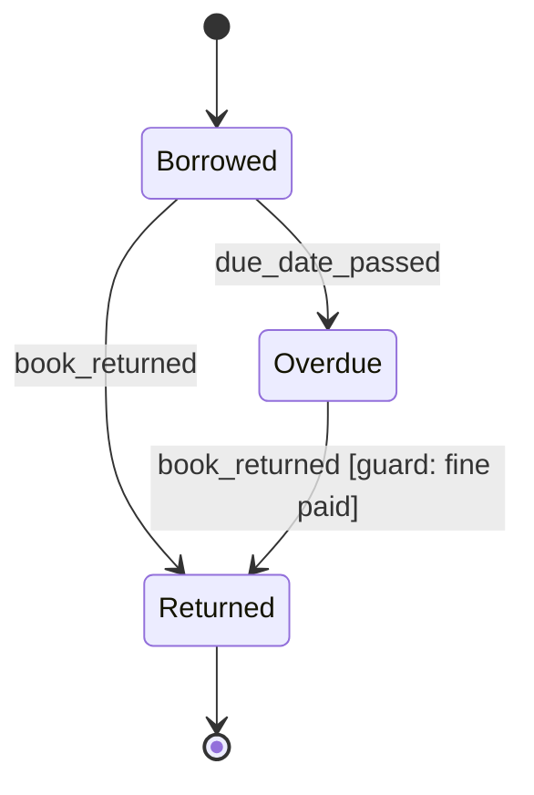

# Week 9 - Transitions

**Theme: state machines, feedback, and what happens between screens.**

## Week at a Glance

| Task ID | Task name | Time | File you will commit |
|---|---|---:|---|
| I1.1 | Subscription state machine | 2 h | `students/UX{n}/week9/I1-1-state-machine.md` |
| I1.2 | Latency plan | 1 h | `students/UX{n}/week9/I1-2-latency-plan.md` |
| I1.3 | Feedback design | 1 h | `students/UX{n}/week9/I1-3-feedback.md` |
| I1.4 | Undo, confirm, and irreversibility | 2 h | `students/UX{n}/week9/I1-4-undo-confirm.md` |
| I1.5 | Transition inventory | 1 h | `students/UX{n}/week9/I1-5-transitions.md` |
| C10.1 | High fidelity interaction states | 1 h + critique 90 min | `students/UX{n}/week9/C10-1-interaction-states.md` |
| C10.2 | State-change microcopy | 1 h | `students/UX{n}/week9/C10-2-state-copy.md` |
| P9.1 | Your interaction principles | 45 min | `students/UX{n}/week9/P9-1-principles.md` |
| P9.2 | Activation and the funnel | 75 min | `students/UX{n}/week9/P9-2-activation-funnel.md` |
| S11 | System contribution | 90 min | `students/UX{n}/week9/S11-system.md` |
| F9.1 | Why session: feedback loops | 20 min | `students/UX{n}/week9/F9-1-why-session.md` |
| F9.2 | Teardown: plan-change flow | 20 min | `students/UX{n}/week9/F9-2-teardown.md` |
| F9.3 | Drill continues | as needed | `students/UX{n}/week9/F9-3-drill.md` |
| L-AI3 | From spec to throwaway prototype | 90 min | `students/UX{n}/week9/L-AI3-prototype.md` |

About 22 hours of work in this week.

All paths in this file start from the repository root and always begin with `Design-Sprint-3/`. The complete prefix for this week is `Design-Sprint-3/students/UX{n}/week9/`.

## 1. What We Are Doing

This week is about transitions, not screens. You map states, events, and guards, then design feedback and copy for what happens between before and after. You also connect the flow to activation metrics and complete the system, fundamentals, and lab work.

Task groups:
- Group 1 - States and latency: I1.1, I1.2, I1.3
- Group 2 - Undo, transitions, and interaction states: I1.4, I1.5, C10.1
- Group 3 - State copy, principles, and activation: C10.2, P9.1, P9.2
- Group 4 - System, fundamentals, and lab: S11, F9.1, F9.2, F9.3, L-AI3

## 2. Why We Are Doing It

A working product designer in India often works on subscription, payment, or account flows. Users judge the product when a card fails, a trial ends, or a cancel button is pressed. This week protects trust in those moments and gives you portfolio evidence that you can design system behavior, not only screens.

## 3. What to Learn First

By the end of the week you can:
- Draw a state machine for a real system and name every transition and guard
- Specify feedback for every action based on its actual latency
- Design the states that exist between "before" and "after"
- Write microcopy for a state change that a user did not initiate

Core ideas to review first:
- Most interfaces are designed as a set of screens. Many bugs live in the transitions between them.
- A state machine names every state, every event, and every guard. It makes impossible states visible before they get built.
- Feedback should match the wait and the risk. A card payment is not a 200ms toggle.
- Undo is often better than a confirmation dialog. Reserve confirmations for genuinely irreversible actions.
- Microcopy for a state change must answer: what changed, why, what it means now, and what to do.
- Activation is a chosen definition with evidence. It is not any number that goes up.
- In About Face, a posture is the way a program behaves toward the user. A daemonic posture runs in the background and speaks up only when something needs attention.
- Use ONE Figma file per sprint named `SPRINT-N UX{n}`, with one page per week. Do not make separate Practice, System, and Delivery Figma files. That breaks the Starter 3-file limit.

## 4. Where to Find Resources

### Your week in order

| Step | Source | What exactly | Time |
|---|---|---|---:|
| Day 1 | About Face, Cooper | The chapters on postures (sovereign, transient, daemonic) and on designing for intermediates | 45 min |
| Day 1 | Statecharts / state machines | statecharts.dev, the "what is a state machine" and "guards" pages (check before use, and confirm the page titles on the site before you read) | 30 min |
| Day 1 | Supplied anonymised screenshots | The screenshots of public product documentation supplied for this week. Do not log in and do not use your own account screens | 15 min |
| Day 2 | NNGroup | "Response Times: The 3 Important Limits" and "Progress Indicators Make Computer Operations Less Annoying" | 25 min |
| Day 2 | Material 3 | The motion and feedback guidance on communicating status | 25 min |
| Day 2 | web.dev | "Optimistic UI patterns" or an equivalent article on optimistic updates and rollback | 25 min |
| Day 3 | About Face | The chapters on undo, on error tolerance, and on preventing errors rather than reporting them | 40 min |
| Day 3 | NNGroup | "Confirmation Dialogs Can Prevent User Errors - If Not Overused" | 20 min |
| Day 4 | Shopify Polaris | The interaction states documentation | 20 min |
| Day 4 | Material 3 | The state layers documentation, how hover, focus, pressed, and dragged compose | 25 min |
| Day 4 | Your I1.1 | Your own state machine, checked against your I1.3 feedback list for gaps | 15 min |
| Day 5 | Nicely Said or Strunk & White | The chapter on writing plainly and cutting words | 25 min |
| Day 5 | Mailchimp Content Style Guide | The voice and tone section, free online | 20 min |
| Day 5 | Google HEART framework paper | The five categories, and the Goals-Signals-Metrics method | 25 min |
| Day 5 | Lean Analytics | The funnel and activation chapters (borrow it) | 20 min |

> **What to take from Day 1:** most interfaces are designed as a set of screens, and the bugs live in the transitions between them. A state machine forces you to name every state, every event, and every guard. It makes impossible states visible before they get built.

> **What to take from Day 3:** undo is almost always better than a confirmation dialog. A confirmation interrupts everyone to protect the few who made a mistake, and people click through them without reading. Reserve confirmations for the genuinely irreversible.

### Tools to open

- Browser: for sources, GitHub, and your markdown files. See `../04-Tools-Setup.md` (browser and GitHub section).
- Figma: for C10.1 and the one-page-per-week file. See `../04-Tools-Setup.md` (Figma section).
- VS Code: for markdown and Mermaid code blocks. See `../04-Tools-Setup.md` (VS Code and Git section).
- If the Figma Starter 3-file limit blocks you, use Penpot (https://penpot.app/). Check the free limit before use.

### Search keywords

Use these when you are stuck:
- state machine guards
- mermaid stateDiagram-v2 example
- optimistic UI rollback
- confirmation dialog undo
- response time feedback UI
- activation metric HEART
- cancel subscription state design

## 5. Step-by-Step Guide

> Every path in this week starts from the repository root with `Design-Sprint-3/`. The complete prefix is `Design-Sprint-3/students/UX{n}/week9/`. In the checklists below, the short form `students/UX{n}/week9/...` means the same path with that prefix. Open a terminal in the repo root.

One task, one commit with all files listed for that task. See `../10-GitHub-For-Designers.md`.

Save your daily notes as `students/UX{n}/week9/session1-learning.md` to `session5-learning.md`.

### Group 1 - States and latency

#### Task - Subscription state machine (ID `I1.1`)

##### 1. What We Are Doing

Draw a state machine for a subscription. Name every state, every event, and every guard. Derive the states and events from the supplied evidence, not from a guess.

##### 2. Why We Are Doing It

Cancel and payment flows fail in the gaps between screens. A clear state machine shows those gaps before they become bugs.

##### 3. What to Learn First

- State: a condition the system can be in.
- Event: something that happens and may move the system.
- Transition: the move from one state to another.
- Guard: the condition that must be true for a transition to happen.
- Mermaid `stateDiagram-v2` syntax, taught below.

##### 4. Where to Find Resources

Use the Day 1 learning table, and the supplied anonymised screenshots of public product documentation.

##### 5. Step-by-Step Guide

1. Open the supplied anonymised screenshots of public product documentation for a subscription product. Do not log in anywhere and do not use private account screens.
2. List every state the product describes in those pages.
3. Add the states the pages do not name but the flow must have. Example: a period after cancelling but before access ends.
4. For every state, list the events that can move it: payment succeeded, payment failed, user paused, user cancelled, period ended, card expired, refund issued.
5. For every transition, write the guard. "User can pause" is not a transition. "User can pause if the subscription is active and has not been paused in the last 30 days" is.
6. Find the impossible combinations and write them down. Can something be paused and past due at the same time? Decide, and say so.
7. Learn the Mermaid syntax below, then draw your machine in one `stateDiagram-v2` block.
8. Check that the diagram renders on GitHub.

Short Mermaid tutorial. The example is a library loan, not a subscription:

- A fenced code block that starts with the word `mermaid` tells GitHub to draw the diagram.
- The line `stateDiagram-v2` names the diagram type. Keep it as the first line.
- `[*]` means the start or the end of the diagram.
- `A --> B: event_name` means the system moves from state A to state B when that event happens.
- Text in square brackets after the event is the guard.
- Open your `.md` file on GitHub to check the drawing appears.

**How to think about it:** start from real user sentences. "I cancelled but I can still open my files." "My card failed but I still have access." Each sentence points to a state and a guard.

**If you get stuck:** read the Day 1 notes again. Search "mermaid stateDiagram-v2 example". Ask in Discord with a screenshot of your diagram and what you tried.

##### 6. What to Commit

- [ ] `students/UX{n}/week9/I1-1-state-machine.md`
- [ ] Eight or more states, each named
- [ ] Every transition has an event
- [ ] Every conditional transition has a written guard
- [ ] Impossible state combinations listed and decided
- [ ] Renders on GitHub
- [ ] Allowed types: `.md`, PNG/JPG under 2 MB, PDF under 10 MB, a view-only Figma link or a view-only Penpot link inside `.md`
- [ ] Commit message: `I1.1 subscription state machine`

#### Task - Latency plan (ID `I1.2`)

##### 1. What We Are Doing

Plan feedback for every server action by its realistic latency. Decide where optimistic UI is safe, and design the rollback.

##### 2. Why We Are Doing It

Users lose trust when a button does nothing, or when a change appears and then disappears. Matching feedback to wait time prevents both.

##### 3. What to Learn First

- Latency bands as design guidance, not fixed rules. They help you choose feedback, and you still judge each action by context and risk.
- Optimistic UI: show the result before the server confirms.
- Rollback: what the user sees when the optimistic result fails.
- Proration: charging only the part of the period the customer actually uses. A plan change in the middle of a month usually involves proration.

##### 4. Where to Find Resources

Use the Day 2 learning table: NNGroup, Material 3, and web.dev.

##### 5. Step-by-Step Guide

1. List every action in your flow that hits a server: sign up, change plan, add card, pause, cancel, reactivate.
2. For each, estimate the realistic latency. A card authorisation is not 200ms.
3. Give every action an immediate acknowledgement within about 100ms, so the user knows the tap registered. This one is a rule, not guidance.
4. Then choose the waiting feedback for each action from its context and risk. The bands below are guidance: under 100ms a state change on the control is usually enough; 100ms to 1s a state change on the control; 1 to 3s a skeleton or an inline spinner; 3 to 10s progress plus a message; over 10s do not block, confirm and notify. Money and irreversible actions need clearer and longer feedback than this guide suggests.
5. For each, decide whether you use optimistic UI.
6. If yes, describe what happens if saving fails. For every optimistic update, describe what happens if saving fails.

Worked example:

| Action | Est. latency | Treatment | Optimistic? |
|---|---|---|---|
| Toggle "email receipts" | ~150ms | Toggle moves immediately, no spinner | Yes. Rollback: toggle returns, inline message "Could not save that setting. Try again." |
| Change plan | 1 to 3s, involves proration | Button enters loading state, disabled, label changes to "Changing plan..." | No. The user must not see a plan change that did not happen. It involves money. |
| Cancel | 1 to 2s | Button loading state, then a full-page confirmation | No. The user must not see a cancelled state that did not happen. |

**How to think about it:** feedback should match the wait and the risk. Fast and low risk can be optimistic. Slow, money-related, or hard to undo cannot.

**If you get stuck:** read the Day 2 notes again. Search "optimistic UI rollback". Ask in Discord with your action list and what you tried.

##### 6. What to Commit

- [ ] `students/UX{n}/week9/I1-2-latency-plan.md`
- [ ] Every server action listed with an estimated latency
- [ ] Immediate acknowledgement specified for every action
- [ ] Waiting feedback chosen from context and risk, with the bands treated as guidance
- [ ] Optimistic decisions made explicitly
- [ ] Every optimistic action has a designed rollback
- [ ] No money-affecting or irreversible action is optimistic
- [ ] Allowed types: `.md`, PNG/JPG under 2 MB, PDF under 10 MB, a view-only Figma link or a view-only Penpot link inside `.md`
- [ ] Commit message: `I1.2 latency plan`

#### Task - Feedback design (ID `I1.3`)

##### 1. What We Are Doing

Specify four feedback moments for every action: immediate, in-progress, success, and failure.

##### 2. Why We Are Doing It

A tap that gives no response feels broken. A failure that leaves the system in an unknown state is worse.

##### 3. What to Learn First

- Immediate feedback: proof the tap registered.
- In-progress feedback: what the user sees while waiting.
- Success feedback: how the user knows it worked.
- Failure feedback: what failed, and what state the system is in now.

##### 4. Where to Find Resources

Use the Day 2 learning table and your I1.2 latency plan.

##### 5. Step-by-Step Guide

1. For every action, specify immediate feedback. What happens within 100ms so the user knows the tap registered?
2. Specify in-progress feedback. What is shown while waiting?
3. Specify success feedback. How do they know it worked? Is the confirmation dismissible or persistent?
4. Specify failure feedback. What do they see, and what state is the system in afterwards?
5. Check the failure trap: after a failure, is the user back where they started, or in a partial state? Say which.

**If you get stuck:** read the Day 2 notes again. Search "response time feedback UI". Ask in Discord with your four-column list and what you tried.

##### 6. What to Commit

- [ ] `students/UX{n}/week9/I1-3-feedback.md`
- [ ] All four specified for every action
- [ ] Immediate feedback exists for every interactive element
- [ ] Success feedback states whether it persists or dismisses, and after how long
- [ ] Failure feedback states what state the system is left in
- [ ] Allowed types: `.md`, PNG/JPG under 2 MB, PDF under 10 MB, a view-only Figma link or a view-only Penpot link inside `.md`
- [ ] Commit message: `I1.3 feedback design`

### Group 2 - Undo, transitions, and interaction states

#### Task - Undo, confirm, and irreversibility (ID `I1.4`)

##### 1. What We Are Doing

Classify every action as reversible, reversible within a window, or irreversible. Design undo or confirmation to match.

##### 2. Why We Are Doing It

Confirmation dialogs interrupt everyone. Undo protects people without slowing down everyone else. The exception is the truly irreversible action.

##### 3. What to Learn First

- Reversible: undo is available.
- Reversible within a window: the window must be visible, and the undo path must be designed.
- Irreversible: no recovery path exists, so the confirmation must name what will be lost, specifically.

##### 4. Where to Find Resources

Use the Day 3 learning table: About Face and NNGroup.

##### 5. Step-by-Step Guide

1. Go through every action in your state machine and classify it: reversible, reversible within a window, or irreversible.
2. For reversible actions, provide undo, not confirmation.
3. For reversible within a window, state the window, make it visible, and show the undo path. Example: "You can reactivate until 14 March", with a Reactivate button on the same banner.
4. For irreversible actions, write a confirmation that names what will be lost, specifically. Not "are you sure?".
5. For cancellation, decide if it takes effect immediately or at the end of the paid period.
6. State why you picked that timing and design what the user sees in the gap.
7. Check that both buttons in every confirmation are equally legible.

Worked example A, reversible within a window:

> **Heading:** "Cancel your subscription on 14 March?"
>
> **Body:** "You keep full access until 14 March. After that: your 47 saved documents stay for 30 days and are then deleted, your team members lose access on 14 March, and your custom templates are not recoverable. You can reactivate any time before 14 March at the same price."
>
> **Actions:** "Cancel subscription" and "Keep my subscription"

This one is reversible within a window, not irreversible. The undo path is reactivation before 14 March. After the click, the user sees a banner: "Your subscription ends on 14 March. Reactivate any time before then." with a Reactivate button. The date in the banner is the visible window.

Worked example B, irreversible:

> **Heading:** "Delete the workspace "Riverside" permanently?"
>
> **Body:** "This deletes 47 documents and 12 templates. It cannot be undone. There is no restore and no backup."
>
> **Actions:** "Delete permanently" and "Keep workspace"

This is honest because it names the numbers, names each consequence separately, and says there is no recovery path. It is also honest because both buttons are equally readable. A design where "Keep my subscription" is a large primary button and "Cancel subscription" is faint grey text is a dark pattern. You will build that deliberately in week 11, not now.

**How to think about it:** protect people from mistakes without interrupting everyone. Use undo where you can. Use a clear confirmation only where undo is impossible.

**If you get stuck:** read the Day 3 notes again. Search "confirmation dialog undo". Ask in Discord with your classification table and what you tried.

##### 6. What to Commit

- [ ] `students/UX{n}/week9/I1-4-undo-confirm.md`
- [ ] Every action classified into the three categories
- [ ] Reversible actions have undo, not confirmation
- [ ] Windowed actions state the window with a real date and show the undo path
- [ ] One truly irreversible action shown as an example, with a confirmation that names specific consequences and numbers
- [ ] The cancellation timing decision is made and justified
- [ ] Both buttons in every confirmation are equally legible
- [ ] Allowed types: `.md`, PNG/JPG under 2 MB, PDF under 10 MB, a view-only Figma link or a view-only Penpot link inside `.md`
- [ ] Commit message: `I1.4 undo confirm and irreversibility`

#### Task - Transition inventory (ID `I1.5`)

##### 1. What We Are Doing

Make one row for every transition in your state machine. Specify what the user sees during and after, and what happens if it fails mid-transition.

##### 2. Why We Are Doing It

A transition is not instant. The design has to survive it failing halfway.

##### 3. What to Learn First

- From state and to state.
- Trigger, guard, and the rest of the row.
- During state and after state.
- Mid-transition failure.

##### 4. Where to Find Resources

Use the Day 4 learning table: Shopify Polaris, Material 3 state layers, and your own I1.1.

##### 5. Step-by-Step Guide

1. Every transition in your state machine gets a row.
2. Add these columns: from state, to state, what triggers it, guard, what the user sees during, what the user sees after, what happens if it fails mid-transition.
3. Copy the guard from I1.1, word for word. If the transition has no guard, write "none". Do not leave the cell empty.
4. Fill every row. The last column matters most.
5. Check that no transition leaves the user unable to tell what state they ended in.

**If you get stuck:** read the Day 4 notes again. Search "interaction states transition". Ask in Discord with a screenshot of one row and what you tried.

##### 6. What to Commit

- [ ] `students/UX{n}/week9/I1-5-transitions.md`
- [ ] Every transition from I1.1 has a row
- [ ] Every row copies its guard from I1.1 or says "none"
- [ ] "During" and "after" both specified
- [ ] Mid-transition failure specified for every one
- [ ] No transition where the user cannot tell what state they ended in
- [ ] Allowed types: `.md`, PNG/JPG under 2 MB, PDF under 10 MB, a view-only Figma link or a view-only Penpot link inside `.md`
- [ ] Commit message: `I1.5 transition inventory`

#### Task - High fidelity interaction states (ID `C10.1`)

##### 1. What We Are Doing

Design eight interaction states for the three most important controls in your flow. Use the shared system and log every extension.

##### 2. Why We Are Doing It

Hover, focus, pressed, loading, disabled, error, and success are part of the interface. They are not extra polish. They are how the product feels real.

##### 3. What to Learn First

- The eight states: default, hover, focus, pressed, loading, disabled, error, success.
- State layers: how hover, focus, pressed, and dragged compose.
- Sprint 1 rules: focus indicators at 3:1, disabled states still measured, real content.
- Extension: a change or addition you make to a shared component. Extensions are allowed. Silent extensions are not.

##### 4. Where to Find Resources

Use the Day 4 learning table. Open Figma. See `../04-Tools-Setup.md` (Figma section).

Use ONE Figma file per sprint named `SPRINT-N UX{n}`, with one page for week 9. Do not make three Figma files per sprint. If the Starter 3-file limit blocks you, use Penpot. Check the free limit before use.

##### 5. Step-by-Step Guide

1. Open your one Figma file for this sprint and go to the week 9 page.
2. Pick the three most important controls in your flow.
3. Design eight states for each control: default, hover, focus, pressed, loading, disabled, error, success.
4. Use the shared system. Extend it only where needed.
5. Log every extension.
6. Check focus indicators at 3:1.
7. Check disabled states are still measured.
8. Use real content, but no real personal data. Use P1, P2 if you need names.

**If you get stuck:** read the Day 4 notes again. Search "Material 3 state layers". Ask in Discord with a screenshot of one control and what you tried.

##### 6. What to Commit

- [ ] `students/UX{n}/week9/C10-1-interaction-states.md`
- [ ] Eight states for each of the three controls: default, hover, focus, pressed, loading, disabled, error, success
- [ ] Focus indicators are at least 3:1
- [ ] Disabled states are still measured
- [ ] Real content is used, with no real personal data
- [ ] Every system extension is logged
- [ ] One Figma file per sprint rule followed, with a view-only Figma or Penpot link in the markdown file
- [ ] Allowed types: `.md`, PNG/JPG under 2 MB, PDF under 10 MB, a view-only Figma link or a view-only Penpot link inside `.md`
- [ ] Commit message: `C10.1 high fidelity interaction states`

### Critique - 90 minutes

Present your state machine and your cancellation confirmation.

Critique focus: is there any state the user can reach where they cannot tell what state they are in?

Add your critique notes to `students/UX{n}/week9/session4-learning.md`.

### Group 3 - State copy, principles, and activation

#### Task - State-change microcopy (ID `C10.2`)

##### 1. What We Are Doing

Write the copy for every state change in your machine, including changes the user did not initiate.

##### 2. Why We Are Doing It

Users need to know what changed, why, what it means now, and what to do. Clear copy keeps trust when something goes wrong.

##### 3. What to Learn First

- Plain writing and cutting words.
- Voice and tone.
- Real dates and real amounts.
- Delivery channel: banner, email, full page.

##### 4. Where to Find Resources

Use the Day 5 learning table: Nicely Said or Strunk & White, Mailchimp Content Style Guide, Google HEART paper, and Lean Analytics.

##### 5. Step-by-Step Guide

1. Write the copy for every state change in your machine.
2. Include the ones the user did not initiate: card expired, payment failed, trial ended, pause auto-resumed.
3. Answer four questions in each: what changed, why, what it means for them right now, and what to do, if anything.
4. Use a real date in every message with a date.
5. Use a real amount in every message with an amount.
6. State the delivery channel for each message.

Worked example:

| State change | Copy | Where |
|---|---|---|
| Active to Past due | "We could not charge your card ending 4412 on 3 March. Your access continues until 10 March. Update your card to avoid interruption." | Persistent banner, plus email |
| Paused to Active (auto) | "Your subscription resumed today as scheduled. Your next payment of ₹499 is on 1 April." | Dismissible banner, plus email |
| CancelPending to Cancelled | "Your subscription ended today. Your 47 documents will be deleted on 13 April. You can download them or reactivate before then." | Full page on next sign-in |

**If you get stuck:** read the Day 5 notes again. Search "UX microcopy state change". Ask in Discord with one message and what you tried.

##### 6. What to Commit

- [ ] `students/UX{n}/week9/C10-2-state-copy.md`
- [ ] Every state change has copy
- [ ] Changes the user did not initiate are included
- [ ] All four questions answered in each
- [ ] Real dates and real amounts throughout
- [ ] Delivery channel stated for each
- [ ] Allowed types: `.md`, PNG/JPG under 2 MB, PDF under 10 MB, a view-only Figma link or a view-only Penpot link inside `.md`
- [ ] Commit message: `C10.2 state change microcopy`

#### Task - Your interaction principles (ID `P9.1`)

##### 1. What We Are Doing

Write five principles you will hold for the rest of this sprint.

##### 2. Why We Are Doing It

Principles help you make hard design choices faster. A principle that cannot be violated is only a slogan.

##### 3. What to Learn First

- A principle must be specific enough to be violated.
- Each principle must state the tradeoff it accepts.
- Platitude: a sentence that sounds good but says nothing you can act on.

##### 4. Where to Find Resources

Use the Day 5 writing sources and your own I1.4 decisions.

##### 5. Step-by-Step Guide

1. Write five principles.
2. For each, make it specific enough that you could point at a design and say it violates this principle.
3. For each, state the tradeoff it accepts.
4. Remove any principle that is a platitude.

Worked example:

> **3. No irreversible action without a named consequence.** Any confirmation dialog must state what specifically will be lost, with numbers where numbers exist. **Tradeoff:** this makes the dialog longer and slows down users who know exactly what they are doing. I accept that, because the cost of the mistake is much higher than the cost of the extra three seconds.

"Be user-friendly" is not a principle. It cannot be violated and it accepts no tradeoff.

**How to think about it:** a good principle will make someone disagree with you. If nobody can disagree, it is too vague.

**If you get stuck:** read the Day 5 notes again. Search "design principles tradeoffs". Ask in Discord with one principle and what you tried.

##### 6. What to Commit

- [ ] `students/UX{n}/week9/P9-1-principles.md`
- [ ] Five principles
- [ ] Each is specific enough that you could point at a design and say it violates this
- [ ] Each names the tradeoff it accepts
- [ ] None is a platitude
- [ ] Allowed types: `.md`, PNG/JPG under 2 MB, PDF under 10 MB, a view-only Figma link or a view-only Penpot link inside `.md`
- [ ] Commit message: `P9.1 interaction principles`

#### Task - Activation and the funnel (ID `P9.2`)

##### 1. What We Are Doing

Draw the funnel, choose an activation definition, and write a metric set with a guardrail.

##### 2. Why We Are Doing It

A funnel shows where users drop. Activation tells you which early action predicts that users stay. A guardrail stops you from hitting one number while damaging something else.

##### 3. What to Learn First

- Guardrail: a second measure you watch so that chasing the main number does not damage something else.
- The HEART paper and the Goals-Signals-Metrics method.
- Funnel and activation chapters in Lean Analytics.
- The numbers in `01-project-brief.md`, sections 1, 4, and 6.

##### 4. Where to Find Resources

Use the Day 5 learning table and `01-project-brief.md`, sections 1, 4, and 6.

##### 5. Step-by-Step Guide

1. Draw the funnel from install to a paying learner at month 3: install, account created, first lesson started, first lesson completed, five lessons in week 1, trial started, first payment, still paying at month 3.
2. Put a number on every step and the drop-off in percentage points.
3. Mark the biggest leak.
4. Propose three candidate definitions of activation as hypotheses. For each, give the event, the time window, and the evidence from the brief's retention data that suggests it predicts staying.
5. Choose one. Defend it against the other two in three sentences. State what it would miss.
6. Write the metric set: one primary metric, two input metrics, and one guardrail.
7. Check the guardrail is not a second success metric. It must protect against hitting the number while damaging something else.
8. Mark which transitions in your I1.1 state machine are funnel steps.

Worked example, a meal-kit subscription, different case:

> Funnel: visit 100,000 to signup 6,200 (6.2%) to first box ordered 1,900 (31% of signups) to second box 1,100 (58%) to still ordering at week 10: 640 (58%).
>
> The biggest leak by volume is visit to signup. The biggest leak that may predict revenue is first box to second box: 640 of the 1,100 people who ordered a second box were still ordering at week 10, about 58%. That is a pattern in one example, not proof. Treat the claim as a hypothesis until you have comparative retention evidence, meaning a retention number for people who did not order a second box.
>
> **Activation (hypothesis) = second box ordered within 21 days.** Rejected: "first box ordered" because it is a purchase, not a habit. Rejected: "app opened 3 times" because it is easy to game and weakly linked to retention. It misses people who buy one large box for an event.
>
> **Guardrail:** week-10 retention and refund rate must not fall. Pushing a discounted second box would lift activation and bring in people who leave at week 10.

**How to think about it:** pick the step that predicts staying, not only the loudest drop. Then add a guardrail that protects the thing you could damage while chasing the number.

**If you get stuck:** read the HEART and Lean Analytics notes again. Search "activation metric HEART". Ask in Discord with your funnel and what you tried.

##### 6. What to Commit

- [ ] `students/UX{n}/week9/P9-2-activation-funnel.md`
- [ ] Funnel with a number on every step and the biggest leak marked
- [ ] Three activation definitions, each written as a hypothesis with evidence from the brief
- [ ] One chosen and defended, with what it misses stated
- [ ] Primary, two input metrics and a guardrail that is not a second success metric
- [ ] State machine transitions mapped to funnel steps
- [ ] Allowed types: `.md`, PNG/JPG under 2 MB, PDF under 10 MB, a view-only Figma link or a view-only Penpot link inside `.md`
- [ ] Commit message: `P9.2 activation and funnel`

### Group 4 - System, fundamentals, and lab

#### Task - System contribution (ID `S11`)

##### 1. What We Are Doing

Contribute one component this sprint needs. Review a peer's contribution. Clear one debt item.

Subtasks:
- S11.1: Contribute one component: a toast or snackbar with undo, a confirmation dialog, a banner, or a plan-selector card. Full documentation standard.
- S11.2: Review a peer's contribution.
- S11.3: Clear one debt item.

##### 2. Why We Are Doing It

The system only grows when people add to it and review it. A component with full documentation can be reused without asking you.

##### 3. What to Learn First

- The full design system sprint comes later, in weeks 13 to 16. This week you use a starter component reference and a documentation template, both supplied for the sprint.
- The documentation standard: the fields in the template, such as states, content rules, and usage notes.
- The extension process, taught in the steps below. Learn it before you add anything.
- How to give a useful peer review.

##### 4. Where to Find Resources

Use the supplied starter component reference and the documentation template for this sprint. Ask in Discord if you cannot find them. Use your C10.1 interaction states. Do not edit `system/` yourself. Put your contribution in your week9 folder. The team leader handles shared updates.

##### 5. Step-by-Step Guide

1. Open the starter component reference and the documentation template supplied for this sprint.
2. Read the template fields before you start. You will fill each field.
3. Learn the extension process. Copy the starter component, rename it for your case, change only what this week needs, and record every change in the template. That record is the extension log.
4. Pick one component from the list.
5. Document it to the full documentation standard.
6. Add its states, content rules, and usage notes.
7. Review one peer's contribution and leave written comments.
8. Clear one debt item.
9. Save your work in your student folder.
10. If the team library is available, ask the admin before adding there. Do not assume the Figma Education plan lifts limits.

**If you get stuck:** read the documentation template again. Search "design system component documentation". Ask in Discord with your component and what you tried.

##### 6. What to Commit

- [ ] `students/UX{n}/week9/S11-system.md`
- [ ] One component contributed: toast or snackbar with undo, confirmation dialog, banner, or plan-selector card
- [ ] Full documentation standard followed, using the supplied template
- [ ] Extension process followed and every change logged
- [ ] One peer contribution reviewed
- [ ] One debt item cleared
- [ ] One Figma file per sprint rule followed, or Penpot if the limit blocks you, with a view-only Figma or Penpot link in the markdown file
- [ ] Allowed types: `.md`, PNG/JPG under 2 MB, PDF under 10 MB, a view-only Figma link or a view-only Penpot link inside `.md`
- [ ] Commit message: `S11 system contribution`

#### Task - Why session: feedback loops (ID `F9.1`)

##### 1. What We Are Doing

Write a why session on feedback loops and the gulf of execution and evaluation. Apply Norman's two gulfs to your own state machine.

##### 2. Why We Are Doing It

The two gulfs explain why users fail: they cannot see what to do, or they cannot see what happened. Your state machine is a tool to close both.

##### 3. What to Learn First

- Gulf of execution: the user cannot see how to act.
- Gulf of evaluation: the user cannot see what happened.
- Feedback loops: action, system response, user understanding.

##### 4. Where to Find Resources

Use your I1.1 state machine and the Day 1 and Day 3 learning notes. Shared reference path from the brief: `fundamentals/why-sessions/week09-feedback-loops.md`. Check with the team leader before writing outside your student folder.

##### 5. Step-by-Step Guide

1. Explain the gulf of execution in your own words.
2. Explain the gulf of evaluation in your own words.
3. Apply both gulfs to your I1.1 state machine.
4. Name one concrete fix for each gulf.
5. Save your notes in your student folder.

**If you get stuck:** read the Day 3 notes again. Search "gulf of execution evaluation". Ask in Discord with your state machine and what you tried.

##### 6. What to Commit

- [ ] `students/UX{n}/week9/F9-1-why-session.md`
- [ ] Norman's two gulfs explained in your own words
- [ ] Both gulfs applied to your I1.1 state machine
- [ ] At least one concrete fix for each gulf
- [ ] Allowed types: `.md`, PNG/JPG under 2 MB, PDF under 10 MB, a view-only Figma link or a view-only Penpot link inside `.md`
- [ ] Commit message: `F9.1 why session feedback loops`

#### Task - Teardown: plan-change flow (ID `F9.2`)

##### 1. What We Are Doing

Tear down a plan-change flow using public documentation only.

##### 2. Why We Are Doing It

A plan change is a real transition with money, confirmation, and failure paths. A teardown shows how another team handled it.

##### 3. What to Learn First

- The states in the plan-change flow.
- The feedback at each step.
- The failure path.
- Public pages only: public help pages, public pricing pages, public product tours, or an anonymised walkthrough supplied to the group.

##### 4. Where to Find Resources

Use public documentation or the supplied anonymised walkthrough. Shared reference path from the brief: `fundamentals/teardowns/09-plan-change.md`. Check with the team leader before writing outside your student folder.

Do not log in to the product. Do not buy anything. Do not submit a plan change. If a step is only visible after login, write "not visible on public pages" and move on.

##### 5. Step-by-Step Guide

1. Choose one SaaS product with a public page that describes its plan change steps, or use the supplied anonymised walkthrough.
2. Capture the states and the feedback at each step from the public pages only.
3. Capture the failure path if the public pages describe it. If they do not, say so.
4. Note one lesson for your own work.
5. Save your notes in your student folder.

**If you get stuck:** read the Day 4 notes again. Search "SaaS plan change UX teardown". Ask in Discord with one screenshot from a public page and what you tried.

##### 6. What to Commit

- [ ] `students/UX{n}/week9/F9-2-teardown.md`
- [ ] One SaaS plan-change flow torn down from public pages only
- [ ] States, feedback, and failure paths named, or marked "not visible on public pages"
- [ ] No login, no purchase, no plan change submitted
- [ ] One lesson for your own work stated
- [ ] Allowed types: `.md`, PNG/JPG under 2 MB, PDF under 10 MB, a view-only Figma link or a view-only Penpot link inside `.md`
- [ ] Commit message: `F9.2 plan change teardown`

#### Task - Drill continues (ID `F9.3`)

##### 1. What We Are Doing

Continue your drill.

##### 2. Why We Are Doing It

Regular drill practice keeps your visual and interaction skills sharp.

##### 3. What to Learn First

Use your current drill brief.

##### 4. Where to Find Resources

Your drill brief and your own notes.

##### 5. Step-by-Step Guide

1. Continue your drill.
2. Add a short note in your student folder if you have changes.

**If you get stuck:** ask in Discord what the current drill step is.

##### 6. What to Commit

- [ ] `students/UX{n}/week9/F9-3-drill.md`
- [ ] Drill note updated
- [ ] Allowed types: `.md`, PNG/JPG under 2 MB, PDF under 10 MB, a view-only Figma link or a view-only Penpot link inside `.md`
- [ ] Commit message: `F9.3 drill note`

#### Task - From spec to throwaway prototype (ID `L-AI3`)

##### 1. What We Are Doing

Do lab L-AI3: from spec to a throwaway prototype, 90 minutes.

##### 2. Why We Are Doing It

A throwaway prototype helps you test an interaction idea before you invest in high fidelity. AI can speed up the first draft, but you still need to judge it.

##### 3. What to Learn First

- The L-AI3 method and done-when checklist.
- The AI log and AI footer rules from doc 07.
- Free limits: check before use.

##### 4. Where to Find Resources

Full method and done-when checklist: `07-AI-In-Design.md` (repository root), section L-AI3.

##### 5. Step-by-Step Guide

1. Open `07-AI-In-Design.md` and read section L-AI3.
2. Choose one free AI tool. Check the free limit before use, before you type anything into it.
3. Then follow the L-AI3 method.
4. Keep your AI log and AI footer as doc 07 says.
5. Save your work in your student folder.
6. Note that week 12b extends this lab into L-AI6, the AI-assisted coded prototype.

**If you get stuck:** read section L-AI3 again. Search "throwaway prototype AI". Ask in Discord with your prompt and what you tried.

##### 6. What to Commit

- [ ] `students/UX{n}/week9/L-AI3-prototype.md`
- [ ] Full L-AI3 done-when checklist from `07-AI-In-Design.md`, section L-AI3, is complete
- [ ] AI log and AI footer are included
- [ ] Allowed types: `.md`, PNG/JPG under 2 MB, PDF under 10 MB, a view-only Figma link or a view-only Penpot link inside `.md`
- [ ] Commit message: `L-AI3 throwaway prototype`

## 6. What to Commit

End of week checklist:
- [ ] 5 learning summaries: `session1-learning.md` to `session5-learning.md`
- [ ] I1.1 through I1.5
- [ ] C10.1 and C10.2
- [ ] P9.1 five principles
- [ ] P9.2 funnel, activation definition, and metric set
- [ ] Critique attended
- [ ] S11 system contribution
- [ ] F9.1, F9.2, F9.3
- [ ] L-AI3 done, 90 minutes
- [ ] One Figma file per sprint rule followed, with a view-only Figma or Penpot link in your markdown file
- [ ] No real names, faces, phone numbers, or IDs anywhere. Use P1, P2 if needed.

If you are short on time, cut in this order:
1. Extra polish on C10.1 states
2. The F9.3 drill note
3. Written peer review detail in S11.2

Keep I1.1, I1.4, I1.5, P9.2, and L-AI3.

When your week is done, open one pull request from your branch and ask for review, following `../10-GitHub-For-Designers.md`.

Next: `03-week10.md`
